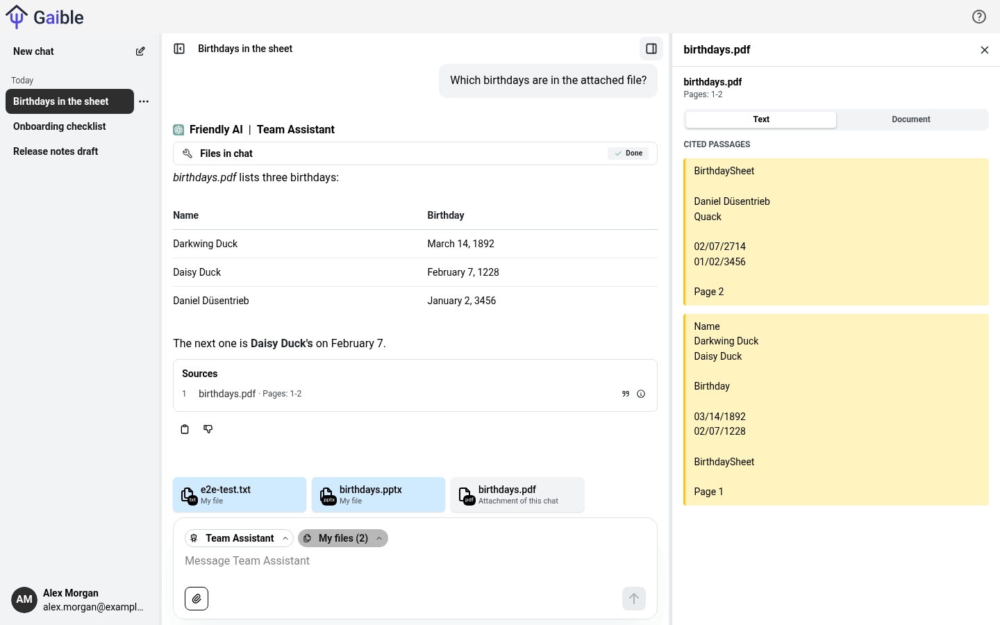
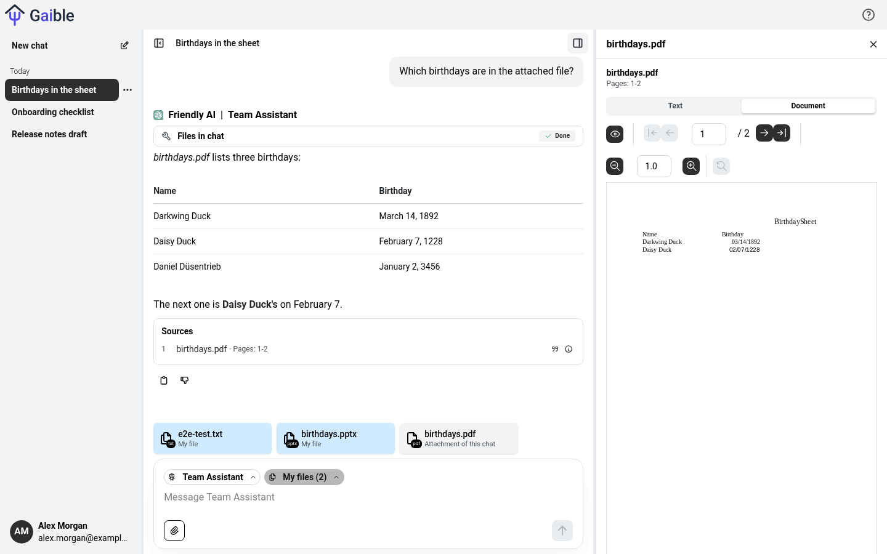
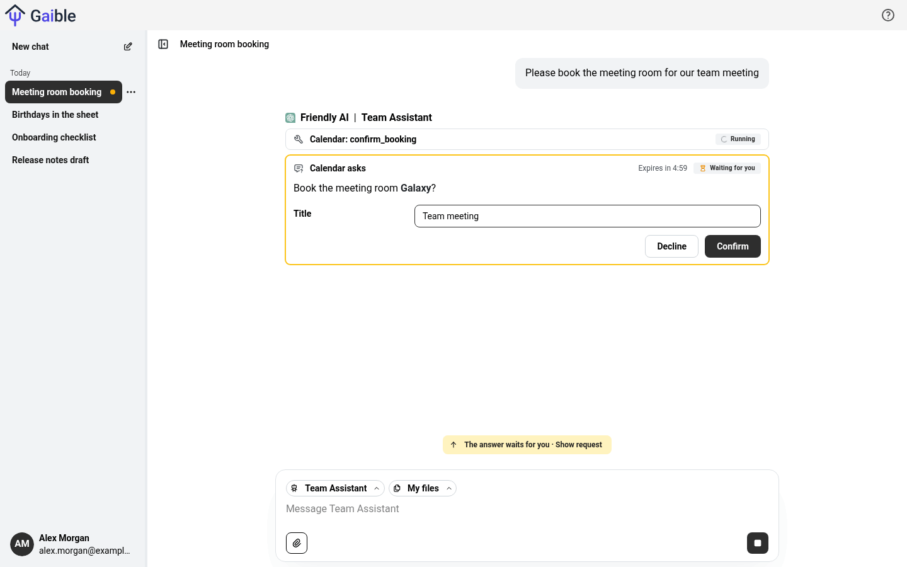
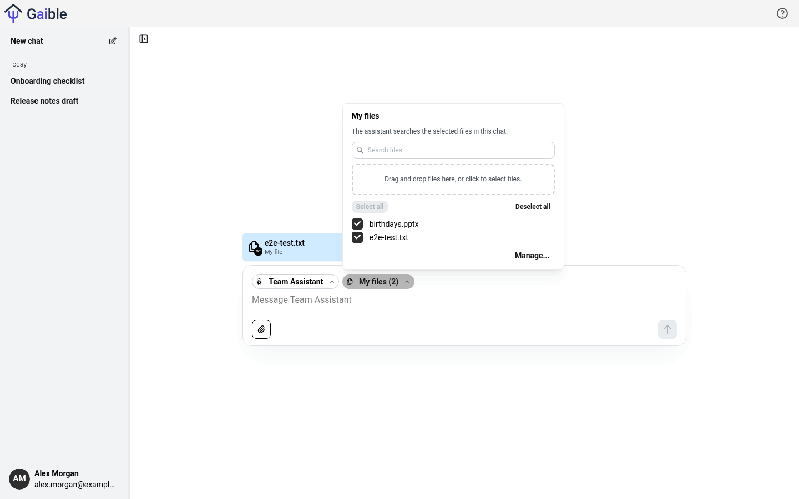
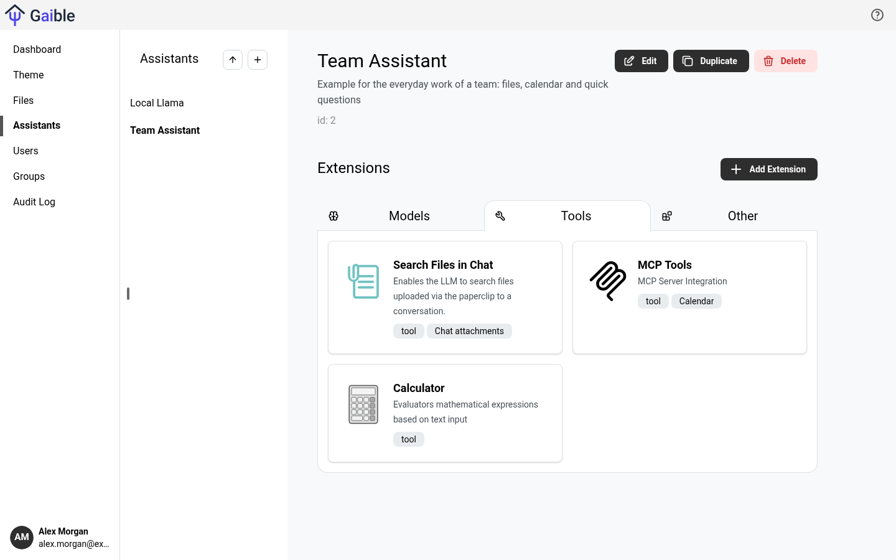
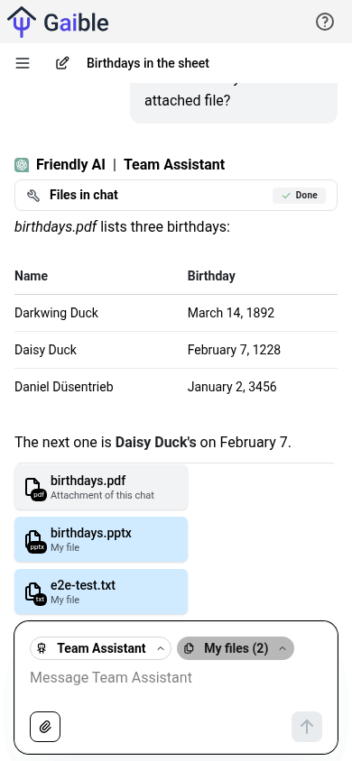

<p align="center">
  
</p>

<p align="center">
  <strong>Self-hosted AI chat for teams: your models, your data, your rules.</strong>
</p>

<p align="center">
  <a href="https://github.com/surt91/gaible/actions/workflows/release.yaml"></a>
  <a href="LICENSE"></a>
  <a href="https://github.com/surt91/gaible/releases"></a>
</p>

<p align="center">
  
</p>

Gaible is a chat application for organizations that want to offer generative AI to their people without handing
their data to yet another SaaS. Administrators compose **assistants** from extensions (a model, tools, MCP servers,
file search, prompts) and decide which user groups may use them. Users chat, attach files and get answers with sources.

## Why Gaible?

- **Any model, also local ones.** OpenAI, Azure OpenAI, Amazon Bedrock, Google GenAI, Mistral, NVIDIA NIM, Ollama and
  every OpenAI-compatible endpoint. Switch providers without retraining your users.
- **Assistants from building blocks.** Combine a model with tools, prompts and file search in the admin UI, no code
  needed. New capabilities are small TypeScript extensions.
- **Answers from your own files.** The built-in RAG server REI-S indexes PDFs, Office and LibreOffice documents,
  e-mails, code, HTML and even audio and video (transcription). Answers cite the passages they are based on.
- **MCP done right.** Connect any MCP server. Tools can ask the user for input or confirmation (elicitation) right in
  the chat, admins decide which tools are enabled and which arguments are fixed.
- **Governance built in.** User groups, monthly token budgets, usage dashboard, audit log and single sign-on.
- **Runs where you want.** Docker Compose for a quick start, a Helm chart for Kubernetes. Apache-2.0 licensed.

## Quickstart

You need Docker with Compose v2. Nothing else, no API key required.

**1. Get the code**

```bash
git clone https://github.com/surt91/gaible.git
cd gaible
```

**2. Start the stack** with a local model (Ollama on the CPU, good for a first look):

```bash
docker compose --profile ollama up
```

The first start pulls the images and then downloads the models `llama3.2` (2 GB) and `all-minilm` (embeddings for the
file search); the container `ollama-models-pull` prints the progress and exits when it is done.
Already have an OpenAI key or another provider? Leave out `--profile ollama`, see [Using a cloud model](#using-a-cloud-model).

**3. Log in and create an assistant**

Open <http://localhost:3333> and log in as `admin@example.com` with the password `secret`.
On a fresh installation the chat stays empty until there is an assistant:

1. Click your name in the bottom left and choose **Admin**, then **Assistants**.
2. **Create assistant**: enter a name and a description and save.
3. Open the assistant, click **Add Extension** and choose **Ollama** with
   - Endpoint: `http://ollama:11434`
   - Model Name: `llama3.2`
4. Click **Test** (should report "Extension is valid") and **Save**.

Click the logo to return to the chat and say hello. To chat about files, create a bucket under **Admin > Files**
(endpoint `http://reis:3201`, type `conversation`) and add the tool **Search Files in Chat** with this bucket to the
assistant. The paperclip in the chat then uploads files, and answers come with their sources.

> [!NOTE]
> `docker compose up` uses the published images of the latest `main` build (`ghcr.io/surt91/gaible/*:main`, amd64).
> Pin a version with `GAIBLE_TAG=<version>`, update with `docker compose pull`, or build from the sources with
> `docker compose up --build` (needed on ARM machines and after code changes, takes several minutes).

### Using a cloud model

Start the stack without the Ollama profile and add a model extension like **OpenAI** (API key and model name, e.g.
`gpt-5-mini`), **Azure OpenAI**, **Amazon Bedrock**, **Google GenAI**, **Mistral** or **OpenAI compatible** (any
endpoint that speaks the OpenAI API, e.g. vLLM, LiteLLM or llama.cpp's `llama-server`) to your assistant.

The file search needs an embedding model as well. Without Ollama, let REI-S use OpenAI by putting this into a `.env`
file next to `docker-compose.yml`:

```bash
REIS_EMBEDDINGS_TYPE=openai
OPENAI_API_KEY=sk-...
```

Or use any OpenAI-compatible embedding server, e.g. a local llama.cpp server
(`llama-server -hf ggml-org/embeddinggemma-300M-GGUF --embeddings --host 0.0.0.0 --port 8081`):

```bash
REIS_EMBEDDINGS_TYPE=openai-compatible
REIS_EMBEDDINGS_ENDPOINT=http://<host>:8081/v1
REIS_EMBEDDINGS_MODEL=embeddinggemma
```

## Screenshots

| | |
|---|---|
|  |  |
| *Sources open in the inspector, PDFs at the cited page* | *MCP tools ask for input or confirmation in the chat* |
|  |  |
| *Personal files: upload once, use them in any chat* | *Admins compose assistants from extensions* |

<p align="center">
  <br>
  <em>Works on phones, too</em>
</p>

## Features

**Models**

- OpenAI, Azure OpenAI, Amazon Bedrock, Google GenAI, Mistral, NVIDIA NIM, Ollama and OpenAI-compatible APIs
- Several models per assistant, reasoning output, vision (images in the chat)
- Image generation with GPT-Image-1 (OpenAI and Azure) and Gemini

**Tools and extensions**

- MCP servers via Streamable HTTP or SSE (stdio servers through the included
  [`mcp-tool-as-server`](dev/mcp-tool-as-server) proxy), with per-tool enablement, descriptions and fixed or
  user-provided arguments
- Elicitation: forms and "open this page" requests from MCP tools, with an optional domain allowlist
- Brave web search, calculator and custom system prompts
- Write your own extension in TypeScript, see [`backend/src/extensions`](backend/src/extensions)

**Files and RAG**

- REI-S, a RAG server with pgvector or Azure AI Search as vector store and embeddings from OpenAI, Azure OpenAI,
  Bedrock, NVIDIA, Ollama or any OpenAI-compatible API
- PDF, Word, Excel, PowerPoint, LibreOffice, Outlook, HTML, Markdown, code, JSON/YAML/XML, audio and video
- Knowledge bases managed by admins, personal files of each user and attachments per chat
- Search or full-document mode, sources with the cited passages and a PDF viewer

**Chat**

- Inspector for sources and tool details, inline cards for tool status, errors and requests
- Rating with comments, duplicate chats, delete with undo, speech input (browser or Azure OpenAI)
- Responsive layout for phones, English and German UI, custom logo, colors and footer

**Admin and governance**

- User groups that control which assistants are available
- Monthly token budgets per group and per user, dashboard with usage and ratings
- Audit log, login with password, Microsoft Entra ID, Google, GitHub or any OAuth2 provider
- HTTP API per assistant with API keys
- LLM evaluation with QA catalogs and metrics (optional [eval service](services/eval))

**Operations**

- Docker Compose and a Helm chart with NetworkPolicies, ServiceMonitors, alerting rules and Grafana dashboards
- Prometheus metrics, OpenTelemetry tracing and Langfuse integration

## Deployment

### Docker Compose

The root [`docker-compose.yml`](docker-compose.yml) is the one way to run Gaible locally and is fine for evaluation
and small teams. Optional parts are enabled with profiles:

| Profile  | Adds                                                                          |
| -------- | ----------------------------------------------------------------------------- |
| `ollama` | a local Ollama (CPU) with `llama3.2` and `all-minilm` (embeddings)            |
| `mcp`    | an example MCP server (`mcp-server-fetch`) at `http://mcp-fetch:8000/sse`      |
| `eval`   | the eval service, its worker and RabbitMQ (see [below](#eval-service))         |

Ports, the admin account, the session secret, the image tag and the embedding model are configured with environment
variables or a `.env` file, see the header of [`docker-compose.yml`](docker-compose.yml).

### Kubernetes

The Helm chart in [`helm-chart/`](helm-chart) is meant for production: external PostgreSQL, ingress, secrets,
metrics and network policies. See its [README](helm-chart/README.md) for all values.

### Security basics

- Change the initial admin password (`ADMIN_PASSWORD` in Compose, `backend.auth.initialAdminPassword` in Helm) and set
  a random `SESSION_SECRET` before anyone else can reach the instance.
- REI-S has no authentication. Only the backend may reach it: Compose binds it to `127.0.0.1`, the Helm chart
  restricts it with a NetworkPolicy.
- Put Gaible behind TLS (the Helm ingress supports it) when it is reachable over a network.

### Eval service

The eval service measures and compares the quality of assistants with QA catalogs. It is disabled by default. Put
the following into `.env` and start with `docker compose --profile eval up`:

```bash
EVAL_SERVICE_ENABLED=true
EVAL_SERVICE_ACCOUNT_API_KEY=...   # openssl rand -hex 32
LLM_EVAL_ENCRYPTION_KEY=...        # python -c 'from cryptography.fernet import Fernet; print(Fernet.generate_key().decode())'
```

See the [eval service README](services/eval/README.md) for details.

## Architecture

```
┌──────────┐     ┌──────────┐     ┌─────────────────────────┐
│  Browser │────►│ Frontend │────►│         Backend         │────► LLM providers
└──────────┘     └──────────┘     │ assistants, extensions, │────► MCP servers
                  React, Vite     │ auth, chat, usage       │
                                  └──┬────────────┬──────┬──┘
                                     │            │      │ (optional)
                                     ▼            ▼      ▼
                              ┌────────────┐  ┌───────┐ ┌──────────────┐
                              │ PostgreSQL │  │ REI-S │ │ Eval service │
                              └────────────┘  └──┬────┘ └──────────────┘
                                                 ├────► Embedding model
                                                 ├────► Vector store (pgvector / Azure AI Search)
                                                 └────► File store (S3 / file system)
```

- **Frontend** ([`frontend/`](frontend)): React, TypeScript and Mantine.
- **Backend** ([`backend/`](backend)): NestJS and TypeORM on PostgreSQL. Runs the chat with the
  [AI SDK](https://ai-sdk.dev), manages assistants, extensions, users and files.
- **REI-S** ([`services/reis/`](services/reis)): the **R**etrieval **E**xtraction **I**ngestion **S**erver, a Python
  (FastAPI) service that extracts, indexes and searches files.
- **Eval** ([`services/eval/`](services/eval)): optional Python service for LLM evaluations.

## Contributing and development

Contributions are welcome. Start with [CONTRIBUTING.md](CONTRIBUTING.md) for the workflow and
[DEVELOPERS.md](DEVELOPERS.md) for the setup with hot reload, the tests and the code generation.
Commit messages follow [Conventional Commits](https://www.conventionalcommits.org/), they drive the changelog and the
releases. Planned work and a comparison with other chat suites are in the [roadmap](docs/roadmap.md) (German).

## License

Gaible is licensed under the [Apache License 2.0](LICENSE). It started as a fork of an Apache-2.0 licensed project
and is developed independently since then.
