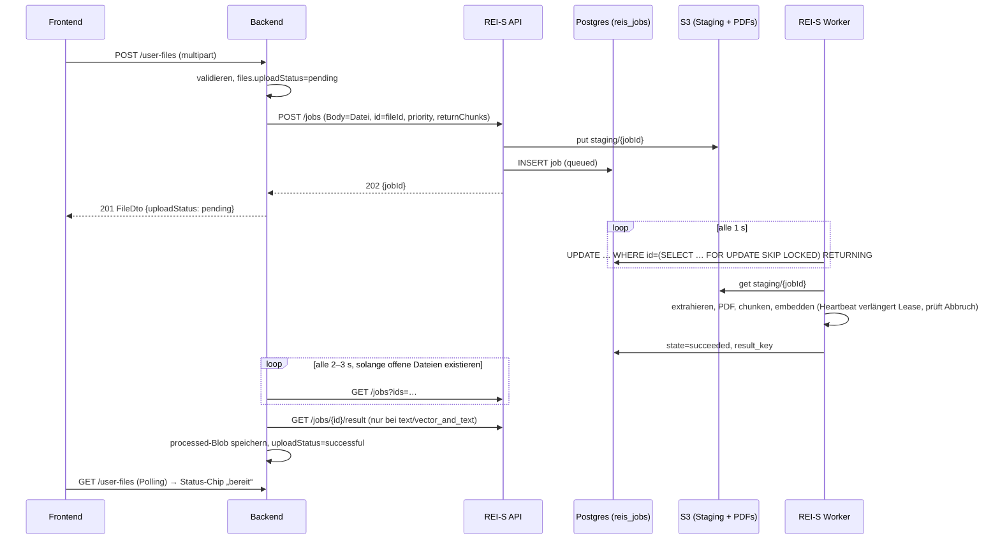
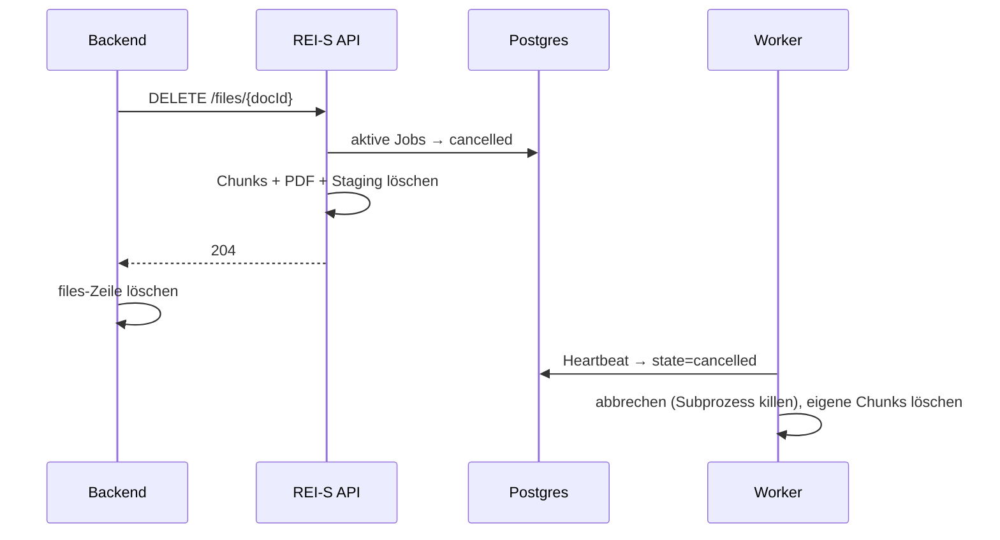

# Konzept: Asynchrone Datei-Ingestion in REI-S

Stand: Oktober 2026 · Status: Entwurf zur Entscheidung

## 1. Problem und Ziel

Dateien werden heute **synchron** verarbeitet. Die HTTP-Kette Browser → Backend → REI-S bleibt offen, bis REI-S die Datei
extrahiert, konvertiert (LibreOffice, ffmpeg, Whisper), gechunkt, eingebettet und gespeichert hat. Bei Videos oder großen
Office-Dateien dauert das Minuten bis Stunden. Ziel ist: Der Upload ist nach dem Speichern der Datei fertig und liefert
`202`/`201` mit dem Status `pending`. Die Verarbeitung läuft danach in einem Hintergrund-Job, der Neustarts übersteht und
dessen Status für die Nutzer sichtbar ist.

## 2. Ist-Analyse

### 2.1 Ablauf

| Schritt                      | Ort                                                                                             | Verhalten                                                                                                                                                                                                                                                                                                                                                                                      |
| ---------------------------- | ----------------------------------------------------------------------------------------------- | ---------------------------------------------------------------------------------------------------------------------------------------------------------------------------------------------------------------------------------------------------------------------------------------------------------------------------------------------------------------------------------------------- |
| Upload „Meine Dateien“       | `frontend/src/pages/chat/files/Files.tsx`                                                       | `postUserFile`, Mutation bleibt `pending`, bis REI-S fertig ist; die Liste pollt jede Sekunde, solange eine Datei `inProgress` ist                                                                                                                                                                                                                                                             |
| Upload im Chat (Büroklammer) | `frontend/src/pages/chat/useChatDropzone.ts`, `conversation/ChatInput.tsx:370`                  | Der Senden-Button ist gesperrt, solange irgendein Upload läuft, im Zweifel also stundenlang                                                                                                                                                                                                                                                                                                    |
| Admin-Bucket                 | `frontend/src/pages/admin/files/FilesPage.tsx`                                                  | `postFile`, Spinner; der Status wird nicht angezeigt                                                                                                                                                                                                                                                                                                                                           |
| Controller                   | `backend/src/controllers/files/user-files.controller.ts:109-200`, `files.controller.ts:226-266` | Multer puffert die ganze Datei im RAM (`app.module.ts:53`, `UPLOAD_MAX_FILE_SIZE_MB`, Default 512) und ruft dann `keepAlive(...)` auf                                                                                                                                                                                                                                                          |
| Keep-Alive                   | `backend/src/controllers/files/keep-alive.ts`                                                   | Nach 3 s werden die Header (200, chunked) gesendet, danach alle 3 s ein `\n`. Ein späterer Fehler kann den Status nicht mehr ändern, **Fehler kommen also als 200 an** (review P2-28, deferred)                                                                                                                                                                                                |
| Use-Case                     | `backend/src/domain/files/use-cases/upload-file.ts:172-260`                                     | `files`-Zeile mit `uploadStatus=inProgress` anlegen. Bei `vector*` folgt `POST /files`, bei `*text` zusätzlich `POST /files/process` (chunkSize 100000) und das Ergebnis landet als `processed`-Blob in Postgres. **Dateien im Chat (`vector_and_text`) werden also zweimal komplett verarbeitet.** Bei einem Fehler wird die Zeile gelöscht; es gibt keinen Status `failed`                   |
| HTTP-Client                  | `backend/src/domain/files/use-cases/utils.ts:83-110`                                            | undici mit `bodyTimeout`/`headersTimeout` = **3 h** (`// FIXME we need a better concept than long lasting connections`)                                                                                                                                                                                                                                                                        |
| REI-S-Endpoint               | `services/reis/rei_s/routes/files.py:179-225`                                                   | Streamt den Body in eine lokale Temp-Datei (`MAX_FILE_SIZE` → 413), `await`et danach `ThreadPoolExecutor(WORKERS)` (`utils.py:30`, Default 1, Compose und Helm 2)                                                                                                                                                                                                                              |
| Verarbeitung                 | `services/reis/rei_s/services/store_service.py:211-241`                                         | Format-Provider suchen (415) → Chunks (große Dateien in einem gespawnten Prozess, `multiprocess_utils.py`) → `vector_store.delete(doc_id)` (Replace-Semantik) → Vorschau-PDF (LibreOffice) in den File-Store (S3/Filesystem, optional) → Embeddings in Batches mit 429-Retry (`tenacity`, bis zu 30 Versuche) in pgvector/Azure AI Search. Bei einem Fehler werden die Teilergebnisse gelöscht |
| Löschen                      | `backend/src/domain/files/use-cases/delete-file.ts` → `DELETE /files/{id}`                      | Synchron: erst REI-S (Chunks + PDF), dann die DB-Zeile. **Race:** Wird eine Datei gelöscht, während sie noch verarbeitet wird, schreibt der laufende Job seine Chunks danach trotzdem → Waisen                                                                                                                                                                                                 |
| Ersetzen                     | –                                                                                               | Es gibt keinen Replace-Endpoint mehr (das `PUT` aus P2-21 existiert nicht mehr). Ersetzen heißt: neue Datei mit neuer ID hochladen und die alte löschen                                                                                                                                                                                                                                        |

Weitere Clients des synchronen Verhaltens: `services/confluence-importer/confluence_importer/gaible.py:141` (erwartet
`201`) und alles, was REI-S direkt aufruft (`reis.networkPolicy.extraIngress`).

### 2.2 Folgen

- Verbindungen über Stunden durch alle Proxies und Ingress-Controller (Timeouts, Abbrüche beim Deployment). Bricht die
  Verbindung ab, verarbeitet REI-S trotzdem weiter, während das Backend die Zeile löscht → Waisen.
- Ein Neustart von REI-S oder dem Backend verliert alle laufenden Uploads. Ein Retry gibt es nur gegen 429 der Embeddings.
- Fehler nach 3 s kommen als 200 an (P2-28). Fehlgeschlagene Dateien verschwinden kommentarlos.
- Keine Back-Pressure: Jeder Upload belegt einen Request-Slot. Mehr REI-S-Replicas verteilen nur die Requests, weil der
  Job-Zustand im Prozess liegt (Temp-Datei, Future).

### 2.3 Vorhandene Infrastruktur

- **Postgres** (`pgvector/pgvector:pg16`) für das Backend und als pgvector-Store für REI-S, in Compose dieselbe Instanz.
  Bei `STORE_TYPE=azure-ai-search` hat REI-S **keine** Postgres-Verbindung.
- **S3** (in Compose S3Mock) als optionaler REI-S-File-Store für die Vorschau-PDFs. Das Backend nutzt kein S3; Originale
  ohne Bucket landen base64-codiert in `blobs`.
- **RabbitMQ + Celery** nur im Compose-Profil `eval`, nicht im Helm-Chart.
- **Helm:** `reis.replicaCount: 1`, `reis.workers: 2`, RollingUpdate, keine HPA. Prometheus-Metriken von REI-S:
  `files_processed_total`, `files_added_to_queue_total` (`rei_s/metrics/metrics.py`).

## 3. Anforderungen

1. Keine langlebigen HTTP-Verbindungen. Der Upload endet nach dem Persistieren der Datei.
2. Jobs überstehen Neustarts und Deployments (Lease plus Wiederaufnahme).
3. Retries mit exponentiellem Backoff für transiente Fehler (Embedding-API, S3, DB). Permanente Fehler (415, defekte
   Datei, 413) schlagen sofort fehl.
4. Idempotent: Derselbe `doc_id` erzeugt keinen zweiten Job und keine doppelten Chunks.
5. Status für die Nutzer: `pending` / `processing` / `ready` / `failed` mit lokalisierter Ursache.
6. Abbruch und Löschen während der Verarbeitung hinterlassen keine Waisen. Replace und Delete laufen in der richtigen
   Reihenfolge.
7. REI-S-Worker lassen sich horizontal skalieren.
8. Back-Pressure: Limit offener Jobs pro User, Queue-Limit in REI-S, Priorität für Chat-Dateien.
9. Observability: Queue-Tiefe, Alter des ältesten Jobs, Dauer pro Format, Fehler nach Ursache, Logs mit `job_id`/`doc_id`.
10. Läuft in Docker Compose und Helm **ohne neue schwere Infrastruktur**.

## 4. Optionen

|                             | (A) Job-Queue in REI-S (Postgres, `SKIP LOCKED`)                                                                                                                    | (B) Queue im Backend (pg-boss / BullMQ / eigene Tabelle)                    | (C) Message-Broker (RabbitMQ)                                       | (D) Direkt-Upload nach S3 (pre-signed) + Event                                         |
| --------------------------- | ------------------------------------------------------------------------------------------------------------------------------------------------------------------- | --------------------------------------------------------------------------- | ------------------------------------------------------------------- | -------------------------------------------------------------------------------------- |
| Idee                        | `POST /jobs` speichert das Original im Staging (S3) und den Job in Postgres, antwortet `202 {jobId}`. Worker in REI-S holen sich Jobs; das Backend pollt den Status | Backend speichert Datei und Job und ruft REI-S aus einem eigenen Worker auf | Backend publiziert, REI-S konsumiert, Status über eine Status-Queue | Browser lädt direkt in S3, ein Event stößt die Verarbeitung an                         |
| Neue Infrastruktur          | keine (Postgres und S3 sind da); bei Azure AI Search ist eine Postgres-URL für REI-S nötig                                                                          | pg-boss: neue Dependency; BullMQ: **Redis** (gibt es nicht)                 | RabbitMQ würde Pflicht, fehlt im Helm-Chart                         | S3 im Backend, CORS, Bucket-Events (S3Mock und viele S3-Implementierungen haben keine) |
| Lange Verbindungen          | keine                                                                                                                                                               | bleiben (nur Backend → REI-S, nicht mehr am User-Request)                   | keine                                                               | keine                                                                                  |
| Neustart-Resilienz          | ja (Lease + Reaper)                                                                                                                                                 | Backend ja; ein REI-S-Neustart bricht den Call ab → Retry von vorn          | ja                                                                  | hängt von der Event-Zustellung ab                                                      |
| Skalierung der Verarbeitung | REI-S-Worker-Replicas, unabhängig von der API                                                                                                                       | weiter über den Load-Balancer, ein langer Request pro Job                   | Consumer-Replicas                                                   | – (löst nur den Upload)                                                                |
| Zustands-Ownership          | klar: REI-S besitzt den Verarbeitungszustand, das Backend die Datei-Metadaten                                                                                       | Backend besitzt alles, REI-S bleibt zustandslos                             | verteilt auf Broker und DB, Status braucht trotzdem eine DB         | unklar (Bucket, Event, DB)                                                             |
| Aufwand                     | M–L (~15–20 PT inkl. UI)                                                                                                                                            | S–M (~8–10 PT), behebt das Kernproblem nur halb                             | L                                                                   | L, eher Ergänzung                                                                      |

**Bewertung**

- **B** ist der kleinste Schritt (z. B. mit einer eigenen `ingestion_jobs`-Tabelle und `SKIP LOCKED` statt pg-boss, um
  keine Dependency hinzuzufügen). Der lange Call bleibt aber bestehen, ebenso der Verlust bei einem REI-S-Neustart. Das
  Backend müsste die Originale zwischenspeichern (bis 512 MB als Postgres-Blob). BullMQ scheidet ohne Redis aus.
- **C** bringt kaum Vorteile gegenüber A: Der Status muss trotzdem in eine DB, und RabbitMQ würde für jede Installation
  zur Pflicht.
- **D** ist sinnvoll gegen den RAM-Puffer im Backend und die Bandbreite durchs Backend, aber erst **auf** A. Der
  Staging-Bereich in S3 ist dann schon vorhanden; Events lassen sich durch ein `POST /jobs` mit `stagingKey` ersetzen.

### Empfehlung: Option A (REI-S-interne Postgres-Queue, Backend pollt)

- Kein neuer Dienst. Die Verarbeitung gehört dorthin, wo die schwere Arbeit passiert, und REI-S-Worker skalieren
  unabhängig vom Backend.
- **Polling statt Webhook:** REI-S hat keine Authentifizierung, und die NetworkPolicy erlaubt nur Backend → REI-S.
  Polling braucht keine Rückrichtung, kein Secret und verliert keine Callbacks. Es läuft per Batch-Abfrage alle 2–3 s,
  aber nur, solange offene Dateien existieren.
- Ein REI-S-Image mit zwei Rollen: `api` (FastAPI) und `worker` (`python -m rei_s.worker`). In Compose genügt ein
  Container mit eingebettetem Worker-Thread (`INGESTION_MODE=embedded`); in Helm gibt es ein eigenes Deployment
  `reis-worker` mit `replicaCount`.

## 5. Entwurf

### 5.1 Ablauf





### 5.2 REI-S

**Tabelle** (eigenes Schema `reis`, Verbindung `JOBS_DB_URL`, Default `STORE_PGVECTOR_URL`):

```sql
CREATE TABLE reis.ingestion_jobs (
  id uuid PRIMARY KEY, doc_id text NOT NULL, index_name text, bucket text NOT NULL,
  file_name text NOT NULL, mime_type text NOT NULL, size bigint NOT NULL, sha256 text NOT NULL,
  staging_key text NOT NULL, options jsonb NOT NULL DEFAULT '{}',   -- store, returnChunks, chunkSize
  state text NOT NULL,            -- queued | running | succeeded | failed | cancelled
  stage text,                     -- extracting | converting | embedding (für die UI)
  priority smallint NOT NULL DEFAULT 0, attempts int NOT NULL DEFAULT 0, max_attempts int NOT NULL DEFAULT 5,
  run_after timestamptz NOT NULL DEFAULT now(), locked_by text, locked_until timestamptz,
  error_code text, error_message text, result_key text,
  created_at timestamptz NOT NULL DEFAULT now(), started_at timestamptz, finished_at timestamptz
);
CREATE UNIQUE INDEX ON reis.ingestion_jobs (coalesce(index_name, ''), doc_id) WHERE state IN ('queued', 'running');
CREATE INDEX ON reis.ingestion_jobs (priority DESC, created_at) WHERE state IN ('queued', 'running');
```

REI-S hat bisher keine Migrationen. Vorschlag: alembic wie im Eval-Service (beim Start `upgrade head`).

**Worker-Regeln**

- _Dequeue:_ `queued AND run_after <= now()` oder `running AND locked_until < now()` (verwaiste Lease), sortiert nach
  `priority DESC, created_at`, mit `FOR UPDATE SKIP LOCKED LIMIT 1`. `attempts+1`, Lease 5 min, Heartbeat alle 60 s.
- _Retry:_ transiente Fehler → `queued`, `run_after = now() + min(2^attempts · 30 s, 30 min)` mit Jitter. Permanente
  Fehler (`ProcessingError`, 415, Größenlimit) → sofort `failed`. Nach `max_attempts` → `failed` mit `error_code`.
- _Commit:_ `UPDATE … SET state='succeeded' WHERE id=$1 AND locked_by=$me AND state='running'`. Bei 0 Zeilen und
  `cancelled` löscht der Worker seine Chunks. Hat er die Lease verloren, bricht er ohne Löschen ab.
- _Idempotenz:_ `POST /jobs` mit gleichem `doc_id`/`index_name` und gleichem `sha256`, während ein Job aktiv ist → `200`
  mit dem bestehenden Job. Bei anderem Inhalt → `409`. Die Replace-Semantik (`vector_store.delete(doc_id)` vor dem
  Schreiben) bleibt.
- _Aufräumen:_ Staging-Objekt nach `succeeded`/`failed`/`cancelled` löschen, Jobs nach `JOB_RETENTION_DAYS` (7) entfernen.
- _Doppelverarbeitung beseitigen:_ Ein Job extrahiert die Datei einmal und liefert bei `returnChunks` zusätzlich das
  `FileProcessResult` (Chunkgröße 100000) als JSON in S3 (`result_key`). Ist das mit den Format-Providern nicht ohne
  zweite Extraktion möglich, bleibt es vorerst bei zwei Chunkings im selben Job, aber ohne zweiten Upload.
- _Staging:_ Mehrere Replicas brauchen einen gemeinsamen Speicher. Mit `FILE_STORE_TYPE=s3` wird das Präfix `staging/`
  im selben Bucket verwendet. Mit `filesystem` oder ohne File-Store ist nur eine Worker-Replica oder ein geteiltes
  Volume möglich (die Startprüfung warnt).

**API** (die synchronen `POST /files` und `/files/process` bleiben als _deprecated_ für eine Major-Version erhalten)

| Endpoint                                        | Zweck                                                                                                                                                                                                                        |
| ----------------------------------------------- | ---------------------------------------------------------------------------------------------------------------------------------------------------------------------------------------------------------------------------- |
| `POST /jobs`                                    | Header wie `POST /files` plus `priority`, `store`, `returnChunks`, `chunkSize`. Sofortige Prüfung von Größe (413) und Format (415). `202 {jobId, state}`. Bei vollem Queue-Limit (`MAX_QUEUED_JOBS`) `503` mit `Retry-After` |
| `GET /jobs?ids=…`                               | Batch-Status: `state`, `stage`, `attempts`, `errorCode`, `errorMessage`                                                                                                                                                      |
| `GET /jobs/{id}/result`                         | `FileProcessResult`, falls `returnChunks` gesetzt war                                                                                                                                                                        |
| `DELETE /jobs/{id}` und `DELETE /files/{docId}` | Abbruch aktiver Jobs plus Löschen der Daten (idempotent)                                                                                                                                                                     |
| `GET /capabilities`                             | `{asyncIngestion: true}`, damit das Backend ältere REI-S-Instanzen erkennt (Buckets können auf verschiedene Endpoints zeigen)                                                                                                |

**Metriken:** `reis_jobs{state}` (Gauge), `reis_job_oldest_queued_seconds`, `reis_job_duration_seconds{format,stage}`
(Histogram), `reis_job_failures_total{error_code}`, `reis_job_retries_total`. Dazu eine PrometheusRule (ältester Job

> 15 min, Fehlerquote) und ein Grafana-Panel. Jeder Log-Eintrag enthält `job_id`, `doc_id` und `attempt`.

### 5.3 Backend

- **Migration `files`:** `uploadStatus` um `pending`, `processing` und `failed` erweitern (`successful` bleibt der
  API-Name für „bereit“, `inProgress` wird zu `processing`, alte hängende `inProgress`-Zeilen werden `failed`). Neue
  Spalten: `uploadError` (i18n-Key, nullable), `reisJobId` (uuid, nullable), `statusUpdatedAt`.
- **Upload** (`upload-file.ts`): validieren → Zeile `pending` → `POST /jobs` → `201` mit `FileDto`. Kein `keepAlive`
  mehr (`keep-alive.ts` entfällt, **P2-28 erledigt**). Der Fallback auf den synchronen Pfad greift nur, wenn
  `GET /capabilities` fehlt.
- **Poller** (`IngestionStatusPoller`, `@Interval`, je Bucket-Endpoint mit dessen Headern): offene Dateien in Batches
  abfragen und den Status übernehmen. Bei `succeeded` + `returnChunks` das Ergebnis holen und als `processed`-Blob
  speichern, erst danach `successful`. Alle Updates sind idempotent (`WHERE uploadStatus IN (...)`), deshalb sind mehrere
  Backend-Replicas unkritisch. Ein unbekannter Job (404) oder ein `pending` ohne Fortschritt nach `INGESTION_TIMEOUT`
  führt zu `failed` (`lost`).
- **Fehler:** `failed` behält die Zeile mit `uploadError` (z. B. `errorUploadingFileDamaged`,
  `errorNotSupportedFileType`, `errorProcessingTimeout`). Der Nutzer löscht die Datei oder lädt sie neu hoch. Ein
  `retry`-Endpoint ist optional (siehe Entscheidungen). Das ersetzt die Löschlogik im `catch` (P2-21/P2-22).
- **Löschen** (`delete-file.ts`): unverändert REI-S zuerst. REI-S bricht dann auch laufende Jobs ab. Der Poller ignoriert
  Jobs ohne `files`-Zeile.
- **Back-Pressure:** `MAX_PENDING_UPLOADS_PER_USER` (Default 10) → `429`. Die Quota zählt `failed` nicht mit. Priorität:
  Chat-Dateien 10, „Meine Dateien“ 5, Admin-Bucket/Importer 0.
- **Chat:** `files-conversation`, `whole-files-conversation` und `files` verwenden nur `successful`-Dateien. Die
  Tool-Beschreibung nennt noch verarbeitete Dateien („`x.pdf` wird noch verarbeitet“), damit das LLM es dem Nutzer sagen
  kann.

### 5.4 Frontend / UX

- **Status-Chips** in „Meine Dateien“ (`Files.tsx`), im Chat (`FileItem.tsx`) und als neue Spalte plus Filter im Admin
  (`FilesPage.tsx`): _Wartet_ (grau), _Wird verarbeitet · Embedding_ (Spinner, mit `stage`), _Bereit_, _Fehlgeschlagen_
  (rot, Tooltip mit Ursache, Aktionen „Entfernen“/„Neu hochladen“). Der Upload-Spinner läuft nur noch während der
  Byte-Übertragung.
- **Polling** über das vorhandene `refetchInterval` (auf 2–3 s gesetzt, solange `pending`/`processing` existieren). Bei
  Wechsel auf _Bereit_/_Fehlgeschlagen_ erscheint ein Toast, wenn die Datei nicht sichtbar ist. Kein WebSocket nötig.
- **Chat:** Der Senden-Button wird **nicht** mehr durch laufende Verarbeitung gesperrt (`ChatInput.tsx:370` nur noch für
  die Übertragung). Hängt eine Datei an, die noch verarbeitet wird, zeigt der Chip „wird noch verarbeitet“. Beim Senden
  gibt es einen Hinweis mit zwei Optionen: **„Warten und senden“** (die Nachricht wird gesendet, sobald alle Dateien
  bereit sind, abbrechbar) und **„Ohne diese Datei senden“**. Fehlgeschlagene Dateien werden nicht mitgesendet und rot
  markiert.

### 5.5 Kompatibilität und Migration

- Die Backend-API bleibt kompatibel bis auf den Zeitpunkt der Fertigstellung: `201` bedeutet „angenommen“, nicht
  „durchsuchbar“. Das ist **BREAKING** für API-Clients, die direkt danach suchen (Changelog). Der Confluence-Importer
  funktioniert weiter (`201`). Die neuen Enum-Werte erfordern `npm run generate-apis`.
- Reihenfolge der Deployments: zuerst REI-S (neue Endpoints, alter Pfad bleibt), dann das Backend (erkennt die Fähigkeit
  pro Bucket-Endpoint). Damit funktionieren gemischte Versionen in beide Richtungen.
- Helm: `reis.worker.enabled/replicaCount/resources`, `reis.jobs.databaseUrl` (Pflicht bei Azure AI Search),
  `reis.jobs.maxQueued`. Mit `reis.worker.enabled=false` läuft der Worker eingebettet im API-Pod. Der Upload-Proxy-Timeout
  kann zurück auf Standardwerte.

## 6. Tests

- **REI-S unit:** Zustandsautomat, Backoff-Berechnung, Klassifizierung permanenter und transienter Fehler, Idempotenz
  (gleicher und anderer `sha256`), Abbruch während `running`.
- **REI-S e2e (Postgres, S3Mock wie `tests/e2e/`):** zwei Worker konkurrieren (kein Job doppelt), Lease-Ablauf nach
  „gekilltem“ Worker, Delete während der Verarbeitung hinterlässt keine Chunks, Staging-Cleanup.
- **Backend:** Poller mit gemocktem REI-S-Client (Statusübergänge, Ergebnis holen, 404 → `failed`), Migration, 429-Limit,
  Chat-Middlewares ignorieren nicht fertige Dateien.
- **Playwright:** ein langsamer Fake über eine nur im E2E-Compose gesetzte Variable (`INGESTION_FAKE_DELAY_SECONDS`, nur
  mit `random-test-embeddings` erlaubt). Geprüft werden: Chip wechselt _Wartet → Bereit_, Senden mit „Warten und senden“,
  Löschen während der Verarbeitung, kaputte Datei → _Fehlgeschlagen_ mit Ursache. Eindeutige Dateinamen (parallel-safe).

## 7. Umsetzung in PRs

| #   | PR                                                                      | Inhalt                                                                                       | Aufwand |
| --- | ----------------------------------------------------------------------- | -------------------------------------------------------------------------------------------- | ------- |
| 1   | `feat(reis): ingestion job table`                                       | alembic, Tabelle, Repository, Config (`JOBS_DB_URL`, Staging)                                | 2 PT    |
| 2   | `feat(reis): ingestion worker`                                          | Dequeue/Lease/Heartbeat/Retry/Abbruch, embedded- und worker-Modus, Metriken                  | 3–4 PT  |
| 3   | `feat(reis): async jobs API`                                            | `/jobs*`, `/capabilities`, Ergebnis in S3, Delete bricht ab, Spec und Clients neu generieren | 2 PT    |
| 4   | `feat(backend)!: asynchronous file uploads`                             | Migration, Upload-Use-Case, Poller, Fehler-Status, `keep-alive.ts` entfernen, Limits         | 3–4 PT  |
| 5   | `feat(backend): ignore files that are still processing in chat`         | Middlewares und Tool-Beschreibung                                                            | 1 PT    |
| 6   | `feat(frontend): file processing status`                                | Chips, Admin-Spalte, Toasts, Chat „Warten/ohne Datei“                                        | 2–3 PT  |
| 7   | `feat(helm): reis worker deployment` + Compose + Dashboard/Alerts + E2E |                                                                                              | 2 PT    |
| 8   | später                                                                  | synchronen Pfad entfernen (Major), Option D (pre-signed Uploads), Retry-Endpoint             | –       |

Summe: **ca. 15–18 PT**. PR 1–3 lassen sich ohne Verhaltensänderung mergen. Erst PR 4 schaltet um.

## 8. Abhängige Themen

- **Hybride Suche + Reranking (Roadmap #3):** Für den `tsvector`-Index müssen bestehende Dokumente neu indiziert werden.
  Das ist ein Massen-Job, der genau diese Queue braucht (Job-Typ `reindex`, niedrige Priorität). Das Reranking betrifft
  nur die Suche und ist unabhängig davon.
- **Docling als PDF-/Office-Parser:** Docling ist deutlich langsamer und speicherhungriger (Layout-Modelle, ggf. OCR,
  optional GPU). Synchron ist das nicht vertretbar. Die asynchrone Ingestion ist **Voraussetzung**; separate
  Worker-Deployments erlauben außerdem eigene Ressourcen bzw. Node-Pools für Docling. Die Bewertung lässt sich über die
  Eval-Kataloge parallel vorbereiten.

## 9. Offene Entscheidungen

1. Option A bestätigen (vs. B als schnellere Zwischenlösung).
2. Polling (empfohlen) oder zusätzlich ein Webhook für geringere Latenz?
3. Postgres-Pflicht für REI-S auch bei Azure AI Search (`JOBS_DB_URL`) akzeptabel?
4. Fehlgeschlagene Dateien behalten (empfohlen, mit „Neu hochladen“) oder automatisch nach N Tagen löschen? Eigener
   Retry-Endpoint ja/nein?
5. Chat-UX: „Warten und senden“ automatisch (Nachricht wird zurückgehalten) oder nur Hinweis plus gesperrter Button?
6. Wie lange bleibt der synchrone REI-S-Pfad bestehen (eine Major-Version)?
