# Konzept: Überarbeitung der Chat-Oberfläche (UI/UX)

Stand: 23.10.2026, Codebasis `main` nach der Umstellung auf Mantine plus „Generierung abbrechen“.
Es geht nur um die Oberfläche für Nutzer (Chat). Der Admin-Bereich ist ausgeklammert.
Das Dokument ist ein Konzept, noch nichts davon ist umgesetzt. Am Ende stehen die
[Entscheidungen](#6-entscheidungen) und ein [Umsetzungsplan](#7-umsetzungsplan).

Die Screenshots in `docs/ux/img/` sind mit Playwright gegen den Compose-Stack und das Mock-LLM entstanden
(englische Oberfläche, Viewport 1440×900 bzw. 390×844). Die Zustände in 15 und 16 (Formular, Tool-Fehler)
wurden mit einem simulierten SSE-Stream erzeugt, sehen aber genauso aus wie echte Events.

Alle Pfade sind relativ zu `frontend/src/` (FE) bzw. `backend/src/` (BE).

---

## 1. Bestandsaufnahme

### 1.1 Gesamtlayout

| Bereich | Umsetzung | Öffnen / Schließen |
|---|---|---|
| Kopfzeile | `components/NavigationBar.tsx`: Logo bzw. Theme-Name. Ein Hilfe-Icon erscheint nur, wenn `/docs/<pfad>/index.md` existiert. | – |
| Linke Spalte (Chats) | `react-resizable-panels`, 15 % (10–40 %), mobil 90 % (`pages/chat/ChatPage.tsx:37-61`) | `CollapseButton` am linken Rand, auf halber Höhe (`top: 40 %`) mit einem kleinen Chevron. Der Zustand wird in localStorage `sidebar-left` gespeichert (`hooks/stored.ts`). |
| Mitte (Konversation) | `pages/chat/conversation/ConversationPage.tsx` | – |
| Rechte Spalte | eine zweite Resizable-Spalte, 20 % (10–40 %), mobil 90 % (`ChatPage.tsx:192-227`) | `CollapseButton` am rechten Rand (nur bei User-Bucket), Klick auf eine Quelle oder X im Panel, siehe [Kapitel 2](#2-die-rechte-spalte) |
| Hilfe-Panel | `components/InAppDocsProvider.tsx`: eigenes, nicht verstellbares Seitenpanel, 33 % ab 80em, sonst Vollbild | Hilfe-Icon / X (`close-icon`) |

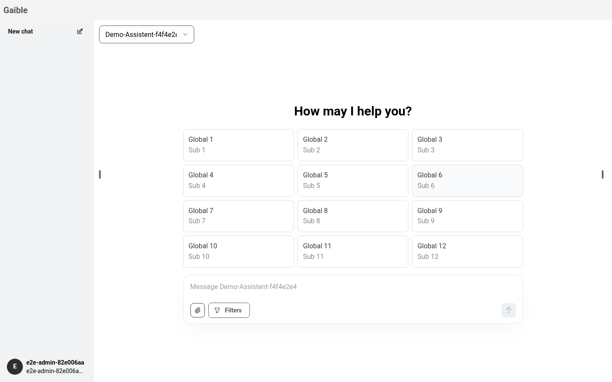

*01: Leerer Chat. Begrüßung, Assistentenauswahl oben links in der Mitte, Eingabe unten.
Die beiden Collapse-Griffe (kleine Striche bzw. Chevrons am Rand der Mitte) sind kaum als Bedienelement zu erkennen.*

### 1.2 Linke Spalte: Chatliste und Nutzermenü

- **„New chat“** (`ChatPage.tsx:129-139`): Ist der aktuelle Chat leer, wird nur das Eingabefeld fokussiert,
  sonst ein neuer Chat angelegt.
- **Chatliste** (`pages/chat/ConversationItems.tsx`), gruppiert nach Heute / 7 Tage / Monat / Jahr. Es gibt
  **keine Suche** (siehe Roadmap #2) und **keinen Leerzustand**.
- **Chat-Eintrag** (`pages/chat/ConversationItem.tsx`): Ein Klick öffnet den Chat. Das „…“-Menü (Mantine `Menu`)
  erscheint nur bei Hover oder Fokus und enthält Rename, Duplicate und Delete.
  - Umbenennen geht inline in einem rohen `<input>` (kein Mantine): Enter speichert, Esc und Blur brechen ab.
    Alternativ geht es per **Doppelklick auf den aktiven Eintrag**, was nirgends angezeigt wird.
  - **Delete löscht ohne Rückfrage** (`ConversationItem.tsx:105-111`). „Alle Chats löschen“ und „Datei löschen“
    fragen dagegen nach.
- **Nutzermenü** (`components/ProfileButton.tsx`, unten links):
  - „Settings“ öffnet `UserProfileModal` mit den Tabs Persönliche Daten und Passwort. Der Eintrag existiert
    **nur bei Passwort-Login**, SSO-Nutzer haben also gar keine Profilansicht.
  - „Admin“ erscheint nicht auf Mobilgeräten.
  - „Clear conversations“ öffnet den Bestätigungsdialog.
  - „Logout“ ist ein hart codierter String und ein `<a href>`.

| | |
|---|---|
| 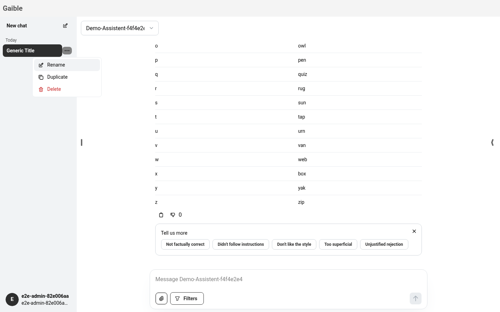 | 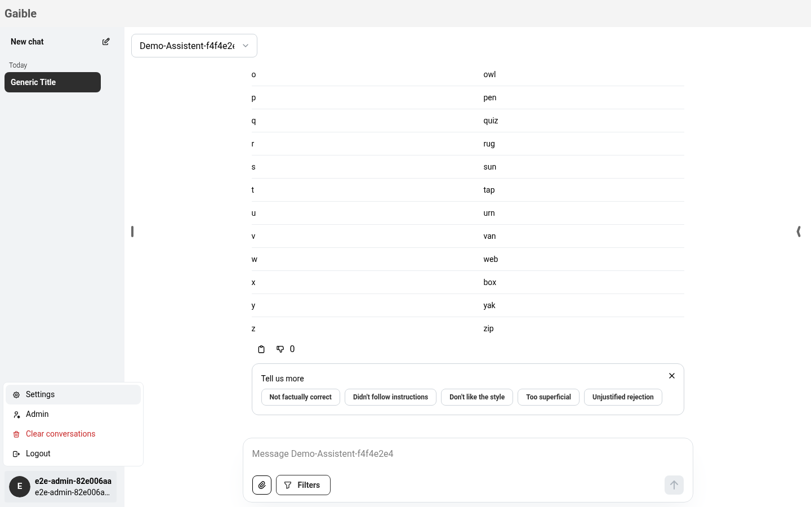 |
| *04: Aktionen eines Chats: Menü am Eintrag, Löschen ohne Rückfrage* | *05: Nutzermenü unten links* |
| 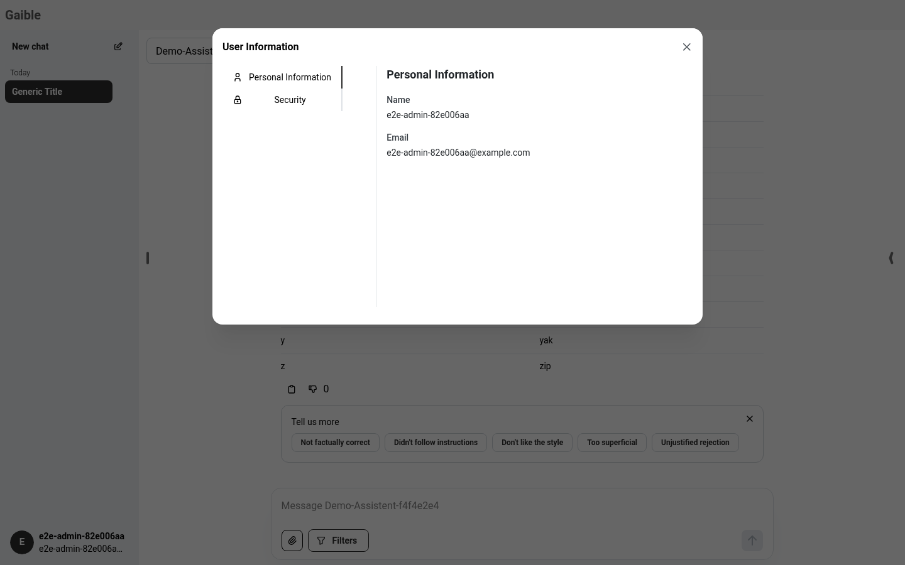 | 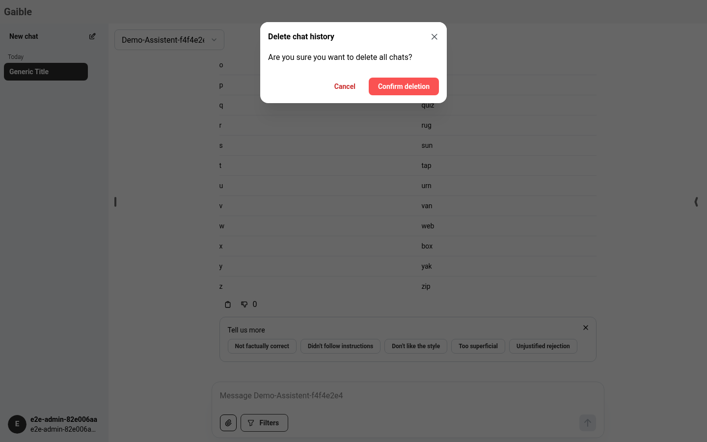 |
| *06: Profil als Modal mit vertikalen Tabs* | *07: Bestätigungsdialog (Abbrechen rot/subtil, Bestätigen rot)* |

### 1.3 Konversation

- **Assistentenauswahl** (`conversation/Configuration.tsx`): ein durchsuchbares `Select` oben links in der Mitte.
  Wenn der Assistent Nutzer-Werte hat, kommt ein Zahnrad dazu, das `ConfigurationUserValuesModal` öffnet.
- **KI-Nachricht** (`conversation/ChatItem/AIChatItem.tsx`), von oben nach unten:
  1. Kopf (Avatar | Agentname | Assistent, ggf. hart codiert „[assistant deleted]“)
  2. Fehler-`Alert`
  3. Tool-Chips (`ChatItemTools.tsx`): Name mit Spinner. Nach dem Ende verschwindet nur der Spinner, ein
     **fehlgeschlagenes Tool sieht aus wie ein erfolgreiches**.
  4. Formular (`ChatItemUserInput.tsx`, siehe [Kapitel 5](#5-mcp-elicitation-und-bestätigungen))
  5. Reasoning (aufklappbar)
  6. Text
  7. **Quellen oder Debug**: `ChatItemDebug` wird ausgeblendet, sobald es Quellen gibt (`AIChatItem.tsx:67-74`).
  8. Hinweis „Generierung abgebrochen“
  9. „Chunks information“ (Logging, aufklappbar)
  10. Aktionen (Kopieren, Bewerten, Token-Zahl für Admins)
- **Bewerten** öffnet ein Inline-Panel unter der Antwort (`AIChatItemActions.tsx:91-189`). Die
  Konversationsbewertung ist dagegen eine schwebende Karte über der Eingabe (`ChatRating.tsx` → `pages/Dialog.tsx`,
  ab 10 Nachrichten) mit „No“ (rot) vor „Yes“ (grün).
- **Eigene Nachricht** (`HumanChatItem.tsx`): Kopieren und Bearbeiten erscheinen bei Hover. Das Bearbeiten
  passiert inline in einem Textarea mit Cancel und „Send“. Esc bricht hier nicht ab.
- **Scroll-to-bottom** schwebt über der Eingabe und ist während des Streamings ausgeblendet.
- **Leer- und Ladezustände**: Der Chat lädt als leeres `div`, ohne Skeleton. Das Profil lädt als `null`, die Seite
  bleibt also weiß. Fehler beim Laden erscheinen als Toast mit anschließendem Redirect. Es gibt keine
  Fehlerseite und keine Error-Boundary.

| | |
|---|---|
| 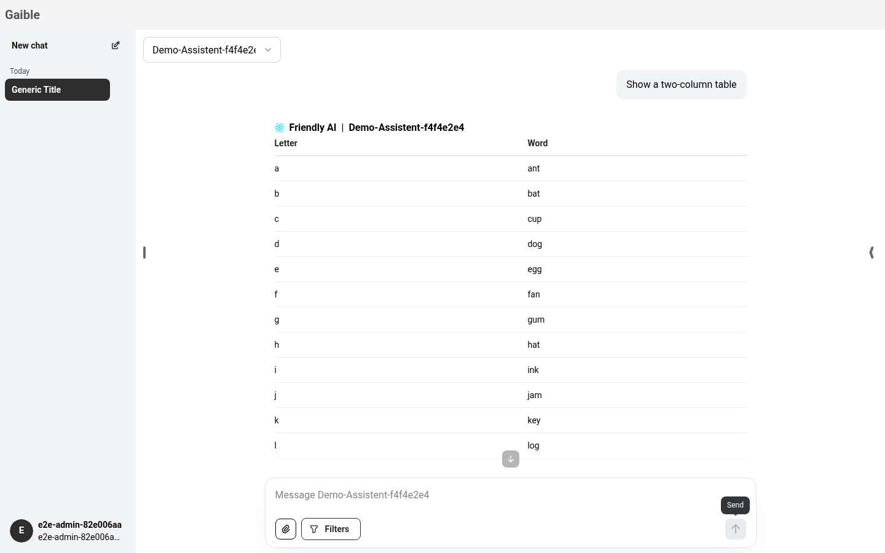 | 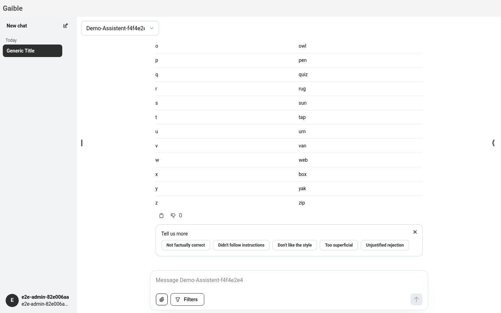 |
| *02: Antwort mit Aktionen. Die Token-Zahl „0“ steht ohne Einheit neben dem Daumen.* | *03: Inline-Bewertung einer Antwort* |
| 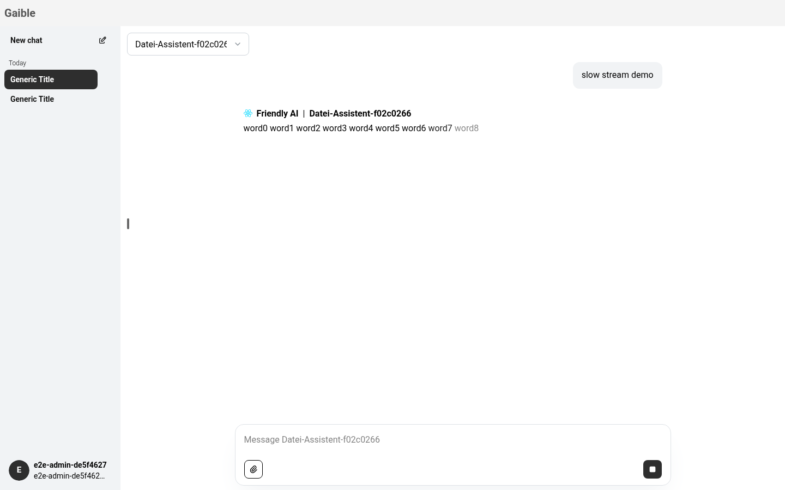 | 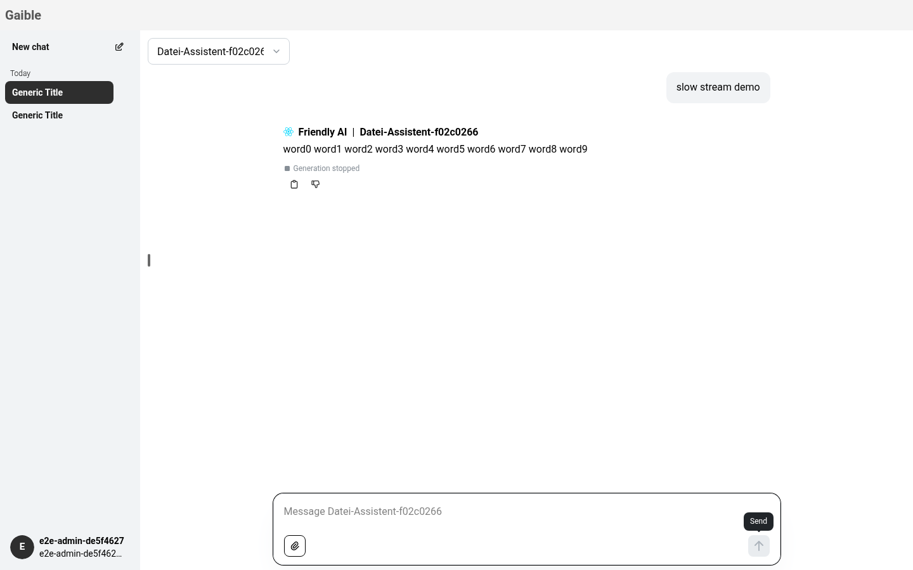 |
| *13: Während des Streamings wird aus dem Senden-Knopf ein Stopp-Knopf* | *14: Abgebrochene Antwort mit Hinweis, bleibt nach Reload erhalten* |

### 1.4 Eingabe

`conversation/ChatInput.tsx`, von oben nach unten:

- Hinweise auf das Upload-Limit (Textzeilen)
- Datei-Chips (`FileItem.tsx`): Diese mischen die im Chat hochgeladenen Dateien mit den **in der rechten Spalte
  angehakten** persönlichen Dateien (`hooks/api/files.ts:27-66`). Woher eine Datei kommt, ist nicht erkennbar.
- Filter-Chips: ein `<div onClick>`, nicht fokussierbar
- Textarea: Enter sendet, Shift+Enter macht eine neue Zeile, Esc stoppt die Generierung
- Werkzeugleiste:
  - Büroklammer (nur mit Conversation-Bucket)
  - „Filters“ (hart codiert, nicht übersetzt) öffnet `FilterModal` mit „Reset all“ links und Cancel /
    „Apply filter“ rechts
  - Mikrofon: entweder Browser-Spracherkennung mit Sprachmenü oder Azure-Transkription
  - Senden bzw. Stopp
- Footer (Markdown aus Assistent und Theme)
- Daneben: Einfügen aus der Zwischenablage (fensterweit) und Drag & Drop auf die ganze Seite mit Overlays
  (`DragAndDropLayout/*`, teilweise hart codiert, „converstation“-Tippfehler)

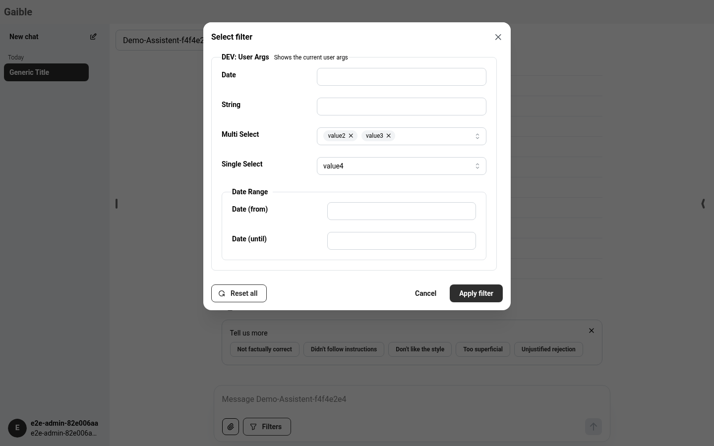

*08: Filter (Nutzer-Argumente einer Extension) als Modal. Das Zahnrad an der Assistentenauswahl öffnet ein
zweites, ähnliches Modal für die Assistenten-Werte: zwei Einstiege für „Einstellungen dieses Chats“.*

### 1.5 Globale Muster

| Thema | Ist-Zustand |
|---|---|
| Toasts | nur `react-toastify`, z. B. Kopieren, Fehler beim Laden, Upload-Fehler, Passwort |
| Modals | eigener Wrapper `components/Modal.tsx`, `withinPortal={false}` als Default. Die Portal-Nutzung ist je Modal anders: FilterModal über `Portal` in `ChatInput`, `ConfigurationUserValuesModal` mit eigenem Portal, `UserProfileModal` ohne. |
| Bestätigungen | `DialogProvider`/`ConfirmDialog` mit rotem Cancel (subtil) und rotem Perform |
| Menüs | Mantine `Menu` (Chat, Nutzer, Sprache), dazu das eigene `OverlayDropdown` (Datei-Karte) |
| Responsiv | `isMobile()` = einmaliges `matchMedia('(max-width: 600px)')` (`pages/utils.ts:15`), nicht reaktiv. Kein `useMediaQuery` im Chat. Das Hilfe-Panel nutzt 80em. |
| Übersetzung | meist das `texts`-Objekt. `SourcesChunkPreview` und `PdfViewer` nutzen `useTranslation().t`, dazu viele hart codierte Strings (s. u.). |
| Tastatur | Enter/Shift+Enter, Esc (Stopp, Umbenennen), keine globalen Shortcuts |

### 1.6 Inkonsistenzen (Auswahl)

1. **Gleiche Aufgabe, verschiedene Muster:**

   | Aufgabe | Umsetzungen |
   |---|---|
   | Einstellungen | Zahnrad-Modal (Assistent), „Filters“-Modal, Profil-Modal |
   | Bewerten | Inline-Panel (Antwort), schwebende Karte (Chat) |
   | Formulare | Inline (Bestätigung, Elicitation), Modal (Filter/Werte) |
   | Löschen | ohne Rückfrage (Chat), mit Dialog (Datei, alle Chats) |
   | Menüs | Mantine `Menu`, `OverlayDropdown` (`pages/chat/files/FileCard.tsx:55`) |

2. **Reihenfolge und Farben der Knöpfe:**

   | Ort | Knöpfe |
   |---|---|
   | Bestätigungsdialog | Cancel (rot, subtil) → Perform (rot) |
   | Modals | Cancel → Save |
   | Formular in der Nachricht | Reject → Confirm |
   | Konversationsbewertung | No (rot) → Yes (grün) |
   | Bearbeiten | Cancel → „Send“ |

   „Reset all“ steht im FilterModal links.
3. **Schließen:**
   - Quellen-Karte und PDF-Viewer haben ein X.
   - Die Dateien-Karte hat keines.
   - Das X einer Quelle schließt nicht das Panel, sondern **wechselt zu den Dateien**.
   - Das Hilfe-Panel hat ein eigenes X mit anderer Breite und anderem Breakpoint.
4. **Versteckte Funktionen:**
   - Umbenennen per Doppelklick
   - Chat-Menü nur bei Hover
   - Aktionen an Nachrichten nur bei Hover (außer der letzten)
   - Collapse-Griffe als 6 px-Striche am Rand
   - Quellen-Metadaten über ein `▶` an einem klickbaren `<li>` ohne Rolle
5. **Status, der nicht sichtbar wird:**
   - Tool-Fehler sehen aus wie Erfolg, der TODO steht in `BE domain/chat/middlewares/execute-middleware.ts`.
   - Debug-Meldungen fehlen, sobald es Quellen gibt.
   - Formulare bleiben nach dem Timeout im Backend (5 min) stehen (`BE domain/chat/services/callback-service.ts`).
6. **Hart codierte oder unübersetzte Texte:**
   - „Filters“ (`ChatInput.tsx`)
   - „Logout“
   - „[assistant deleted]“/„[disabled]“
   - „Collapse“/„Expand“ (`ReasoningLoadingIndicator.tsx`)
   - die Drag & Drop-Overlays
   - die Aria-Labels im PDF-Viewer (`components/PdfViewer.tsx`, `PdfControlBar.tsx`, u. a. „rest zoom level“)
   - die Extension-Titel „Bilder im Chat“/„Files Vision“ in `pages/chat/files/Files.tsx`
7. **Typografie und Abstände:**
   - Die Quellen nutzen ein `<h2>` „Sources“ in einer Karte, die Gruppentitel der Chatliste ebenfalls `<h2>`.
   - Die Tool-Chips sind gerahmte Markdown-Blöcke.
   - Die Inline-Formulare haben andere Innenabstände als Modals.
   - Es gibt Inline-Styles (`ConversationPage.tsx`, `ChatPage.tsx`, `SpeechRecognitionButton.tsx`).
8. **Barrierefreiheit:**
   - nicht semantische Klickflächen (Filter-Chip, Quelle, „Delete“ als `<a>` ohne `href`)
   - Externer-Link-Icon ohne Label
   - Die rechte Spalte heißt je nach Inhalt „files“ oder „Source Content“.

---

## 2. Die rechte Spalte

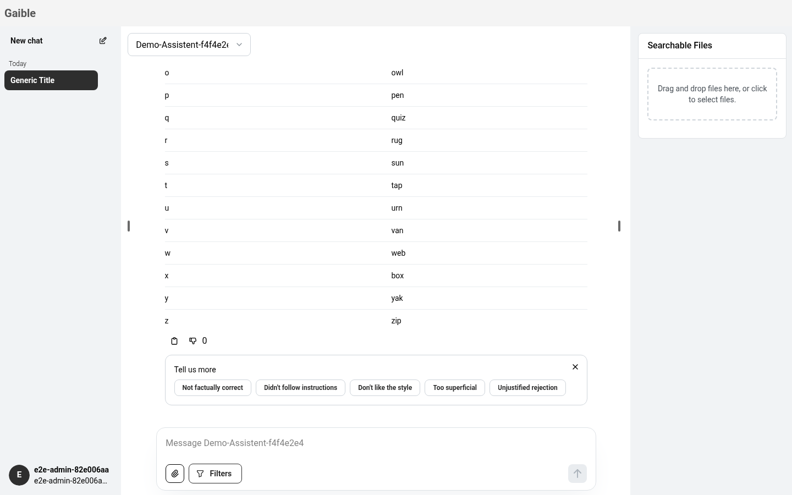

*09: Rechte Spalte im Dateimodus („Searchable Files“): persönliche Dateien zum Anhaken für den Chat.*

| | |
|---|---|
| 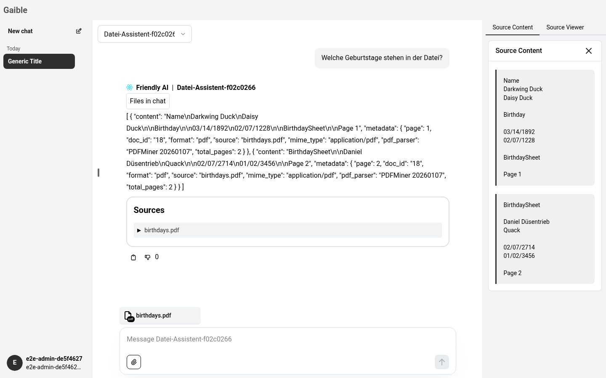 | 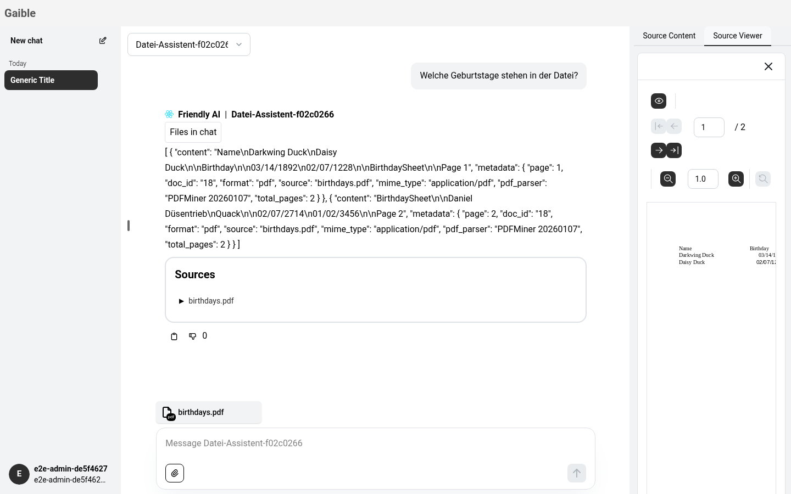 |
| *11: Nach Klick auf eine Quelle: Tabs „Source Content“ / „Source Viewer“, darunter eine Karte mit eigenem X.* | *12: PDF-Ansicht im zweiten Tab* |

### 2.1 Was heute passiert

Die Spalte hat zwei Modi, die sich gegenseitig ausschließen (`ChatPage.tsx:192-227`):

1. **Dateimodus** (`pages/chat/files/Files.tsx`):
   - Nur wenn der Assistent einen **User-Bucket** hat.
   - Inhalt: Upload-Dropzone, Liste mit Checkboxen („für diesen Chat verwenden“), Paginierung,
     Alle auswählen/abwählen.
   - Löschen über ein eigenes Dropdown.
   - Öffnen und Schließen nur über den Collapse-Griff am rechten Rand.
2. **Quellenmodus**:
   - Ein Klick auf einen Quellentitel in einer Antwort öffnet die Spalte **erzwungen**
     (`ChatHistory.tsx:23-29` setzt `sidebar-right=true`).
   - Inhalt: zwei Tabs, Chunk-Vorschau und PDF-Viewer. Den PDF-Tab gibt es nur, wenn ein Download möglich ist.
   - Das X schließt die Quelle. Gibt es einen User-Bucket, erscheinen wieder die Dateien, sonst schließt die
     Spalte.
   - Beim Chatwechsel wird die Quelle zurückgesetzt.

### 2.2 Probleme

- **Informationsarchitektur:**
  - Zwei Inhalte ohne Bezug teilen sich einen Ort: *meine Dateien* (Eingabe-Kontext, chatübergreifend) und
    *Belege einer Antwort* (Ausgabe-Kontext, nachrichtenspezifisch).
  - Die Spalte hat keinen festen Titel, kein Tab „Dateien“ neben „Quellen“ und keinen Zurück-Weg. Aus der Quelle
    kommt man nur per X in die Dateien.
- **Auffindbarkeit:**
  - Ob es die Spalte gibt, hängt von der Assistenten-Konfiguration ab.
  - Der einzige Einstieg ist ein unbeschrifteter Griff am Rand.
  - Dass angehakte Dateien in der Eingabe als Chips auftauchen, erschließt sich nicht. Die Chips sehen genauso aus
    wie hochgeladene Dateien, man sieht also nicht, wo man eine Datei „abwählt“.
  - Doppelter Einstieg für Dateien: Büroklammer (Chat-Dateien, Conversation-Bucket) und die rechte Spalte
    (persönliche Dateien, User-Bucket), ohne dass der Unterschied erklärt wird.
- **Wann sie aufgeht:**
  - Der Zustand liegt global in localStorage und wird beim Öffnen einer Quelle überschrieben. Wer die Spalte
    geschlossen hatte, hat sie danach dauerhaft offen.
  - Beim Assistentenwechsel ohne User-Bucket verschwindet sie samt Griff.
- **Inhalt:**
  - Doppelte Titel: Tab „Source Content“ plus Kartentitel „Source Content“.
  - Je Tab ein eigenes X.
  - Die Chunk-Vorschau zeigt Rohtext ohne Hervorhebung der zitierten Stelle.
  - Der PDF-Viewer springt zur ersten zitierten Seite, markiert sie aber nicht.
  - Für mehrere Quellen einer Antwort gibt es keine Liste und kein Weiterblättern.
- **Größe:**
  - Mit 20 % ist die Spalte für einen PDF-Viewer zu schmal (bei 1440 px rund 290 px).
  - Die Breite wird nicht gespeichert.
- **Mobil:**
  - 90 % Breite, die Konversation wird durch eine graue Fläche ersetzt.
  - `isMobile()` ist nicht reaktiv: Wer das Fenster verkleinert oder das Tablet dreht, bekommt das falsche Layout.
  - Links und rechts können nicht beide sinnvoll offen sein, das Überlagerungsverhalten ist undefiniert.
- **Abgrenzung:**
  - Das Hilfe-Panel ist ein *zweites* rechtes Seitenpanel mit eigener Breite, eigenem Breakpoint und eigenem
    Close-Verhalten.
  - Künftig kommen Artifacts (Roadmap, „Seitenpanel“) und ggf. Tool-Details dazu. Ohne ein gemeinsames Konzept
    gibt es bald drei konkurrierende Seitenpanels.

| | |
|---|---|
| 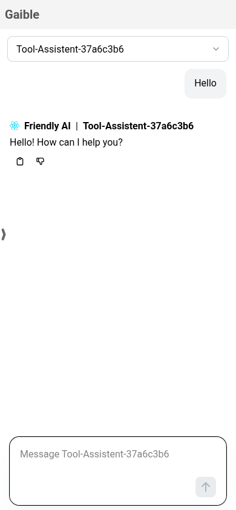 | 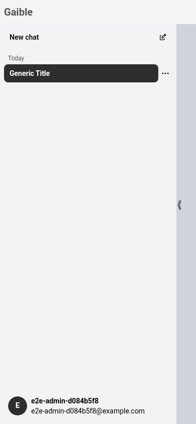 |
| *17: Mobil, Griff links (Chevron) als einziger Einstieg in die Chatliste* | *18: Mobil, linke Spalte offen, der Rest grau* |

---

## 3. Einheitliches Interaktionsmodell (Vorschlag)

### 3.1 Wofür welches Muster?

| Muster | Wofür | Beispiele (neu) | Nicht dafür |
|---|---|---|---|
| **Inline im Verlauf** (Karte in der Nachricht) | alles, was *zu einer bestimmten Antwort* gehört und den Verlauf dokumentiert | Tool-Aufrufe inkl. Status/Fehler, Bestätigungen und Elicitation, Fehler, „abgebrochen“, Quellenliste, Bewertung einer Antwort | lange Inhalte (PDF), globale Einstellungen |
| **Seitenpanel rechts** („Inspector“) | *Detailansicht* zu etwas im Verlauf oder Arbeitsmaterial des Chats, das neben dem Lesen offen bleiben soll | Quelle/PDF, künftig Artifacts, Tool-Details (Ein-/Ausgabe), Dateien des Chats | Entscheidungen, die den Ablauf blockieren |
| **Modal** | *blockierende*, kurze Aufgaben ohne Bezug zum Verlauf, mit klarem Abschluss | Profil/Einstellungen, destruktive Bestätigungen (Löschen), Umbenennen auf Mobilgeräten | Formulare der KI (die gehören in den Verlauf) |
| **Popover/Menü** | kurze Auswahl oder Aktionen an einem Element | Chat-Aktionen, Assistentenwahl, Spracheinstellung, Quellen-Metadaten | Formulare mit mehr als 1–2 Feldern |
| **Composer-Bereich** (über der Eingabe) | Kontext, der *in die nächste Nachricht* eingeht | Anhänge, ausgewählte Dateien, Filter-Chips, Assistent-Einstellungen als Chips | Ausgaben der KI |
| **Toast** | flüchtige Bestätigung ohne Handlungsbedarf | „Kopiert“, „Dupliziert“ (mit „Öffnen“) | Fehler, die eine Aktion erfordern (die erscheinen inline oder im Formular) |

Daraus folgt:

- *Eingabe-Kontext* (Dateien, Filter, Werte) lebt im Composer. Seine Detail-Bearbeitung öffnet sich als Popover
  bzw. im Panel-Tab „Dateien“.
- *Ausgabe-Kontext* (Quellen, Tools, Artifacts) lebt inline, Details zeigt das Panel.

### 3.2 Gemeinsame Bausteine

- `SidePanel` (ein Panel für Quellen, Dateien, Artifacts, Hilfe):
  - Kopf mit Titel, optional Zurück, Schließen (X, Esc)
  - Tabs oder ein Stapel von Ansichten
  - gespeicherte Breite
  - unter `md` als Mantine `Drawer`
- `ChatCard` für alle Inline-Karten (Tool, Formular, Fehler, Hinweis): Icon, Titel, Status-Badge, Inhalt,
  Aktionsleiste. Gleiche Abstände, gleiche Typografie (Titel `sm`/600, Text `sm`, Meta `xs dimmed`).
- `ConfirmModal` mit festen Regeln:
  - sekundär links, primär rechts
  - destruktiv = rot nur am primären Knopf
  - Esc und Klick daneben = Abbrechen
  - Fokus auf dem nicht destruktiven Knopf
- Knopfregeln für alle Formulare: `[Abbrechen/Ablehnen] [Primär]`, rechtsbündig. Die Primärbeschriftung ist ein
  Verb („Termin anlegen“, „Bestätigen“), nicht „OK“.
- Ein Menü-Baustein (Mantine `Menu`). `OverlayDropdown` entfällt.
- Ein Status-Vokabular für laufend, erfolgreich, Fehler, abgebrochen, wartet auf dich, abgelaufen, mit festen
  Farben und Icons.
- Alle Texte in `texts`, kein `useTranslation` direkt in Komponenten.

### 3.3 Responsiv

- Breakpoints aus dem Mantine-Theme mit `useMediaQuery` (reaktiv), `isMobile()` entfällt.
- **≥ lg (1200 px):**
  - Chatliste als feste Spalte, einklappbar
  - Inspector als verstellbare Spalte (Default 33 %, min 320 px), Breite gespeichert
- **md–lg:**
  - Chatliste als Overlay-Drawer
  - Inspector als Spalte
- **< md:**
  - Chatliste und Inspector als Drawer (links bzw. unten/rechts, Vollbild)
  - Burger-Knopf in der Kopfzeile
  - Inspector mit Zurück-Pfeil
  - Es ist immer höchstens einer offen.
- Die Collapse-Griffe am Rand werden durch **beschriftete Icon-Buttons in einer Kopfzeile der Konversation**
  ersetzt: links „Chats“, rechts „Dateien“/„Quellen“ mit Zähler-Badge.

### 3.4 Tastatur und Barrierefreiheit

| Taste | Aktion |
|---|---|
| Esc | schließt Popover → Panel → stoppt die Generierung (in dieser Reihenfolge) |
| Ctrl/Cmd+K | Chat suchen/wechseln (zusammen mit Roadmap #2) |
| Ctrl/Cmd+Shift+O | neuer Chat |
| Ctrl/Cmd+. | Inspector ein/aus |
| ↑ im leeren Eingabefeld | letzte eigene Nachricht bearbeiten |

Weitere Regeln:

- Sichtbare Aktionen statt reinem Hover: Auf Touch-Geräten und für die fokussierte Nachricht sind die Aktionen
  immer sichtbar. Das Chat-Menü bleibt per Tastatur erreichbar, und „Umbenennen“ steht als Eintrag im Menü (der
  Doppelklick bleibt als Abkürzung).
- Live-Region (`aria-live="polite"`) für Status: Generierung gestartet, abgebrochen, wartet auf Bestätigung,
  Fehler.
- Fokus-Management:
  - Ein neues Formular im Verlauf bekommt den Fokus. Danach geht er zurück ins Eingabefeld.
  - Das Panel setzt den Fokus beim Öffnen auf seinen Titel und gibt ihn beim Schließen an den Auslöser zurück.
- axe-Check in den E2E-Tests (`expectA11yCompliant`) für jeden neuen Zustand.

---

## 4. Alternativen für die rechte Spalte

### Variante A: Kontext-Inspector mit Tabs (eine Spalte, feste Tabs)

```
┌────────┬──────────────────────────────────────┬──────────────────────────┐
│ Chats  │ [≡] Assistent ▾  ⚙            [Panel]│ Quellen │ Dateien │ (Art.) │
│        │                                      ├──────────────────────────┤
│ Heute  │  Du: Welche Geburtstage …            │ ◀ 1/3 ▶  birthdays.pdf   │
│ > Chat │                                      │ Seite 2 · Treffer 2      │
│   Chat │  KI: Daisy Duck hat am …  [1][2]     │ ┌──────────────────────┐ │
│        │   ▸ Dateien im Chat ✓                │ │ …Daniel Düsentrieb … │ │
│        │   Quellen: [birthdays.pdf p.1-2]     │ │ ███ markiert ███     │ │
│        │                                      │ └──────────────────────┘ │
│        │ ┌──────────────────────────────────┐ │ [Text] [PDF]  ⤓  ↗       │
│        │ │ 📎 birthdays.pdf  🗂 2 Dateien   │ │                          │
│        │ │ Nachricht …                  [↑] │ │                          │
└────────┴─┴──────────────────────────────────┴─┴──────────────────────────┘
```

Feste Tabs: „Quellen“ (zur gewählten Antwort, mit Blättern zwischen den Quellen) und „Dateien“ (persönliche
Dateien plus Dateien dieses Chats an einem Ort). Später kommt „Artifacts“ dazu. Ein Klick auf eine Quelle wählt
den Tab und öffnet das Panel, ohne die gespeicherte Präferenz zu überschreiben. Die Tabs sind immer da (leere
Zustände mit Erklärung), damit die Struktur lernbar ist.

| Pro | Contra |
|---|---|
| Kleinster Schritt vom Ist-Zustand, gleiche Komponenten | Tabs werden mit Artifacts/Tool-Details voll |
| Feste Orte sind lernbar, Dateien sind nicht mehr „versteckt“ | Quellen und Dateien bleiben im selben Panel (aber klar getrennt) |
| Mobil einfach als Drawer mit Tabs | – |

**Aufwand:** S–M (Frontend), kein Backend.

### Variante B: Inspector als Detail-Stapel, Dateien in den Composer

```
┌────────┬──────────────────────────────────────┬──────────────────────────┐
│ Chats  │ [≡] Assistent ▾                      │ ← Quellen der Antwort  ✕ │
│        │                                      ├──────────────────────────┤
│        │  KI: Daisy Duck hat am …  [1][2]     │ birthdays.pdf · S. 2     │
│        │   Quellen: [1 birthdays.pdf] [2 …]   │ ┌──────────────────────┐ │
│        │   ▸ Tool: Dateien im Chat ✓  (Det.)  │ │ PDF, Treffer markiert │ │
│        │                                      │ └──────────────────────┘ │
│        │ ┌──────────────────────────────────┐ │                          │
│        │ │ [birthdays.pdf ✕] [Meine Dateien: 2 ▾]                      │ │
│        │ │ Nachricht …          📎  🎙   [↑]│ │                          │
└────────┴─┴──────────────────────────────────┴─┴──────────────────────────┘
                 ▲ Popover „Meine Dateien“: Suche, Checkboxen, Upload, „Verwalten…“
```

Das Panel öffnet sich **nur auf Anforderung** für eine Detailansicht (Quelle, Tool-Details, Artifact) und hat
einen Stapel mit Zurück. Persönliche Dateien wandern in den Composer: ein Chip „Meine Dateien (2)“ öffnet ein
Popover zur Auswahl und zum Hochladen. Die Verwaltung (löschen, umbenennen) geschieht in einem Modal bzw. später
auf einer eigenen Seite „Meine Dateien“.

| Pro | Contra |
|---|---|
| Klare Trennung: Eingabe-Kontext im Composer, Ausgabe-Details im Panel | Größerer Umbau, Nutzer müssen die Dateien neu finden |
| Panel ist standardmäßig zu, mehr Platz zum Lesen | Popover ist für viele Dateien (Paginierung) eng → braucht Suche |
| Skaliert für Artifacts und Tool-Details (Stapel statt Tabs) | E2E-Tests für Dateien müssen umgeschrieben werden |
| Mobil natürlich: Composer-Popover als Bottom-Sheet | – |

**Aufwand:** M (Frontend). Backend optional (Dateisuche im User-Bucket).

### Variante C: Quellen inline, kein ständiges rechtes Panel

```
┌────────┬────────────────────────────────────────────────────────────────┐
│ Chats  │  KI: Daisy Duck hat am …  [1][2]                               │
│        │   ┌ Quellen ──────────────────────────────────────────────────┐│
│        │   │ [1] birthdays.pdf S.1  „Name Darkwing Duck …“      ↗ PDF  ││
│        │   │ [2] birthdays.pdf S.2  „BirthdaySheet Daniel …“    ↗ PDF  ││
│        │   └───────────────────────────────────────────────────────────┘│
│        │                         ┌──── Modal (groß) ──────────────────┐ │
│        │                         │ birthdays.pdf  S. 2 / 2   ✕        │ │
│        │                         │   PDF mit Markierung …             │ │
│        │                         └────────────────────────────────────┘ │
└────────┴────────────────────────────────────────────────────────────────┘
```

Quellen erscheinen als aufklappbare Karte mit Zitat direkt in der Antwort. Das PDF öffnet sich in einem großen
Modal (bzw. Vollbild mobil). Die Dateien wandern wie in B in den Composer. Ein rechtes Panel gibt es erst wieder
für Artifacts.

| Pro | Contra |
|---|---|
| Einfachstes Layout, keine zweite Spalte, mobil ideal | Antwort und PDF nicht nebeneinander lesbar (Modal blockiert) |
| Zitat sofort sichtbar ohne Klick | Lange Quellenlisten blähen den Verlauf auf |
| Weniger Zustand (kein Panel-Status) | Für Artifacts braucht es später doch ein Panel → Konzept in zwei Schritten |

**Aufwand:** S–M (Frontend).

### Empfehlung

**Variante B**: ein Inspector, der nur auf Anforderung aufgeht, und die Dateien im Composer.

- B trennt Eingabe- und Ausgabe-Kontext sauber.
- B passt zum Interaktionsmodell aus 3.1.
- B ist die Grundlage für Artifacts und Tool-Details (Roadmap).
- Aus C wird das *Inline-Zitat* in der Quellenkarte übernommen, damit man für einen kurzen Blick nicht das Panel
  öffnen muss.
- Wenn der Umbau zu groß ist: zuerst A als Zwischenschritt (feste Tabs, gleiche Komponenten), später B.

---

## 5. MCP-Elicitation und Bestätigungen

### 5.1 Ist-Zustand

- **Backend:**
  - `context.ui.form(text, schema)` (`BE domain/chat/middlewares/ui-middleware.ts`) sendet ein SSE-Event
    `{type:'ui', request:{id,text,schema}}` und wartet auf `DELETE /conversations/confirm/:id`
    (`conversations.controller.ts`).
  - Ein Timeout von 5 min führt zu `cancel` (`callback-service.ts`).
  - Seit „Generierung abbrechen“ wird ein offenes Formular beim Stopp mit `cancel` beendet.
  - Der Confirm-Endpunkt prüft **nicht**, ob die Request-ID dem aufrufenden Nutzer gehört. Die ID ist eine
    zufällige UUID, sollte aber trotzdem an Nutzer und Konversation gebunden werden.
- **Nutzer:**
  - MCP-Elicitation im Formularmodus (`BE extensions/tools/mcp-tools.ts`, `enableElicitRequests`)
  - OpenAPI-Tools mit `confirm`/`input` (`open-api.ts`)
  - Beispiele in `extensions/examples/`
- **URL-Modus** wird mit `cancel` abgelehnt, nur mit einem Log-Eintrag. Der Nutzer erfährt davon nichts, die KI
  bekommt nur „abgebrochen“.
- **Frontend:**
  - `ChatItemUserInput` rendert das Formular inline in der KI-Nachricht (Bild 15).
  - Es gibt keinen Zustand „wird gesendet“, „abgelaufen“ oder „beantwortet: …“.
  - Nach dem Absenden verschwindet das Formular spurlos. Nach dem Reload sieht man nicht, was bestätigt wurde.
  - Es fehlt die Angabe, *wer* fragt (Server/Tool).

| | |
|---|---|
| 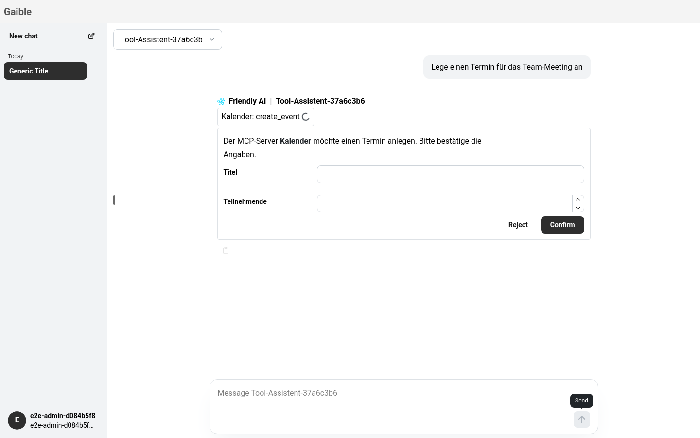 | 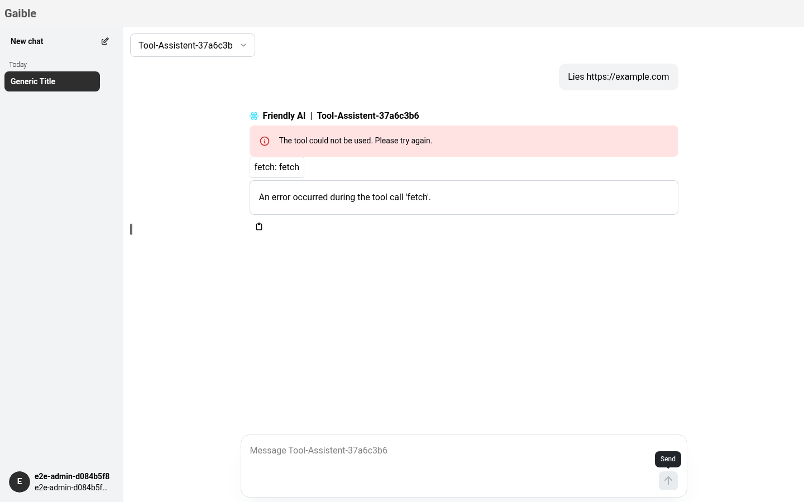 |
| *15: Elicitation/Bestätigung inline. Der Tool-Chip läuft weiter, Absender und Frist sind nicht erkennbar.* | *16: Tool-Fehler: Fehler-Alert oben, Tool-Chip ohne Fehlerstatus, Debug-Text als graue Box darunter: drei Darstellungen für ein Ereignis.* |

### 5.2 (a) URL-Modus

Im URL-Modus der MCP-Spezifikation (2025-11) bittet der Server den Client, eine URL zu öffnen, z. B. für einen
OAuth-Login bei einem Drittdienst oder eine Zahlung. Sensible Daten laufen dabei bewusst **nicht** durch den
Client. Die Spezifikation verlangt:

- die URL bzw. Domain klar anzeigen
- eine ausdrückliche Zustimmung, kein automatisches Öffnen und kein Vorladen
- das Öffnen in einem normalen Browser-Kontext

Der Server meldet den Abschluss asynchron (`notifications/elicitation/complete` mit `elicitationId`). Ein
Tool-Aufruf kann außerdem mit „URL-Elicitation erforderlich“ (`-32042`) fehlschlagen. Die Details sind bei der
Umsetzung gegen die dann aktuelle Spezifikation und das SDK zu prüfen.

**Vorgeschlagene UX** (Inline-Karte, wie alle Formulare, siehe 5.3):

```
┌ 🔗 Kalender-Server möchte, dass du eine Seite öffnest ───────── wartet ┐
│ „Bitte melde dich bei Kalender an, damit Termine angelegt werden       │
│  können.“                                                              │
│                                                                        │
│  Ziel:  login.kalender.example   🔒 https                              │
│         https://login.kalender.example/authorize?…   [Details ▾]       │
│  ⚠ Die Seite gehört nicht zu Gaible. Gib dort nur Daten ein, wenn du   │
│    dem Anbieter vertraust.                                             │
│                                                                        │
│                     [Ablehnen]   [In neuem Tab öffnen ↗]               │
│  Läuft ab in 9:42                                                      │
└────────────────────────────────────────────────────────────────────────┘
   nach dem Öffnen:  „Warte auf Abschluss in login.kalender.example …“
                     [Ich bin fertig]  [Abbrechen]
```

Regeln:

1. **Domain prominent:** Die Domain wird als Hostname dargestellt (eTLD+1 hervorgehoben, Punycode/IDN als
   `xn--` sichtbar). Die volle URL ist aufklappbar. Nur `https:` ist erlaubt (Ausnahme `http://localhost` in der
   Entwicklung).
2. **Explizite Zustimmung:**
   - Erst der Klick auf „In neuem Tab öffnen“ öffnet `window.open(url, '_blank', 'noopener,noreferrer')`.
   - Es gibt kein automatisches Öffnen, keine eingebetteten iframes und kein Prefetch.
3. **Zurückkehren:**
   - Die Karte wechselt auf „wartet auf Abschluss“.
   - Kommt `notifications/elicitation/complete`, wird die Karte grün („Anmeldung abgeschlossen“) und das Tool
     läuft weiter.
   - Fallback „Ich bin fertig“, falls der Server keine Benachrichtigung schickt: Der Tool-Aufruf wird erneut
     versucht.
4. **Abbrechen / Ablehnen:** Ergibt `decline` bzw. `cancel`, und die Karte zeigt das Ergebnis dauerhaft
   („abgelehnt“).
5. **Timeout:**
   - Die Frist ist sichtbar.
   - Bei Ablauf zeigt die Karte „abgelaufen“, die Knöpfe sind deaktiviert, und die KI erhält `cancel`.
   - Die Frist für den URL-Modus ist länger (Vorschlag 10 min), da Logins dauern.
6. **Allowlist (Admin):** Je MCP-Extension optional die erlaubten Domains. Andere Domains werden abgelehnt oder
   mit Warnung angezeigt (Entscheidung E8).
7. **Audit-Log:** URL-Elicitation angefordert, zugestimmt, abgeschlossen (ohne Query-Parameter, die Tokens
   enthalten können).

**Nötige Änderungen:**

- **Backend:**
  - `ChatUI` um `openUrl({ message, url, elicitationId, timeout })` erweitern. Neues Stream-Event
    `{type:'ui', request:{ id, kind:'url', text, url, domain, expiresAt }}`.
  - Validierung der URL (Schema, Allowlist).
  - `CallbackService` mit eigener Frist.
  - Die Benachrichtigung `notifications/elicitation/complete` des MCP-Clients wird auf die Callback-ID abgebildet
    → neues Stream-Event `ui_update` (Status `completed`).
  - Fehlerbehandlung für `-32042` beim Tool-Aufruf (URL-Elicitation erforderlich): Karte anzeigen, nach Abschluss
    das Tool erneut aufrufen.
  - Das Capability-Flag `elicitation: { form: {}, url: {} }` im Client.
  - Confirm-Endpunkt an Nutzer und Konversation binden.
- **Frontend:**
  - `ChatCard` Variante „URL“ mit Domainanzeige und Countdown.
  - Statusmaschine *wartet → geöffnet → abgeschlossen / abgelehnt / abgelaufen*.
  - Texte de/en.
- **Persistenz:** Ergebnis der Karte (Typ, Server, Domain, Status, Zeitpunkt) an der KI-Nachricht speichern
  (z. B. JSON-Spalte `interactions`), damit es nach dem Reload sichtbar bleibt.
- **Tests:**
  - Ein Mock-MCP-Server mit Elicitation (Formular und URL) als E2E-Fixture. Heute fehlt eine Möglichkeit,
    Formulare im E2E auszulösen.
  - Backend-Unit-Tests für Validierung, Timeout und Abbruch.

**Bezug zu „MCP-OAuth 2.1“ (Roadmap #1):**

- **MCP-OAuth** autorisiert den *Client gegenüber dem MCP-Server* (Token je Nutzer/Extension, PKCE, DCR).
- **Der URL-Modus** autorisiert den *MCP-Server gegenüber einem Drittdienst* (der Client sieht kein Token).

Beide brauchen dieselbe UX: „Du musst dich anmelden“ mit Domain, Zustimmung, neuem Tab, Rückkehr und Status. Der
„Re-Auth-Hinweis im Chat“ aus der Roadmap sollte deshalb **dieselbe Karte** verwenden, beim OAuth-Fall mit
Redirect auf einen Gaible-Callback statt `elicitation/complete`. Empfehlung: Karte und Statusmaschine einmal
bauen, zuerst für den URL-Modus (kleiner), und bei MCP-OAuth wiederverwenden.

### 5.3 (b) Dialog oder inline?

Betroffen sind drei Arten von Ereignissen: Elicitation-Formulare, Tool-Bestätigungen und Tool-Fehler.

**Option 1: Inline-Karte im Verlauf** (heute für Formulare, weiterentwickelt)

```
 KI │ ▸ Kalender: create_event      ⏳ wartet auf dich
    │ ┌ Kalender-Server fragt ─────────────────────────────── 4:59 ┐
    │ │ Termin „Team-Meeting“ am 24.10. 10:00 anlegen?             │
    │ │ Titel [Team-Meeting      ]  Teilnehmende [5 ]              │
    │ │                               [Ablehnen] [Termin anlegen]  │
    │ └────────────────────────────────────────────────────────────┘
 danach (dauerhaft, auch nach Reload):
    │ ✓ Bestätigt: Termin anlegen (Titel: Team-Meeting, 5)   10:02
```

**Option 2: Modal-Dialog**

```
           ┌──────────── Kalender-Server fragt ───────────── ✕ ┐
           │ Termin „Team-Meeting“ am 24.10. 10:00 anlegen?    │
           │ Titel [Team-Meeting]   Teilnehmende [5]           │
           │                     [Ablehnen] [Termin anlegen]   │
           └───────────────────────────────────────────────────┘
   (Verlauf abgedunkelt; im Verlauf danach nur eine Zeile „✓ bestätigt“)
```

**Option 3: An den Composer angedockt** (ersetzt die Eingabe, solange eine Antwort aussteht)

```
 KI │ ▸ Kalender: create_event      ⏳ wartet auf dich (unten)
 ───┼──────────────────────────────────────────────────────────────
    │ ┌ Kalender-Server fragt ───────────────────────────── 4:59 ┐
    │ │ Termin anlegen?  Titel [Team-Meeting]  Teiln. [5]        │
    │ │                    [Ablehnen] [Termin anlegen]  [Stopp]  │
    │ └──────────────────────────────────────────────────────────┘
```

| | Inline | Modal | Composer |
|---|---|---|---|
| Bezug zur Antwort / Nachvollziehbarkeit | ✅ steht an der Stelle, dauerhaft | ⚠️ nur als Protokollzeile | ⚠️ nur als Protokollzeile |
| Auffälligkeit, wenn man weggescrollt ist | ⚠️ braucht Hinweis (Badge im Composer, Auto-Scroll, Live-Region) | ✅ | ✅ dort, wo der Blick ist |
| Blockiert Lesen des Verlaufs | ✅ nein | ❌ ja | ✅ nein |
| Mehrere Fragen nacheinander/parallel | ✅ natürlich | ⚠️ Stapel von Modals | ⚠️ Warteschlange |
| Lange Formulare | ⚠️ ok bis ~5 Felder | ✅ | ❌ eng |
| Mobil | ✅ | ⚠️ Vollbild | ⚠️ verdrängt Tastatur/Eingabe |
| Konsistenz mit Tool-Status und Fehlern (die inline sind) | ✅ ein Muster | ❌ | ⚠️ |
| Wechsel des Chats während Wartezeit | ✅ Karte bleibt im Chat, Badge in Chatliste | ⚠️ Modal muss chat-gebunden sein | ⚠️ |
| Aufwand | S (Ausbau) | S–M | M |

**Empfehlung: Option 1, inline, als einheitliche `ChatCard`**, ergänzt um die Auffälligkeit aus Option 3:

- **Ein Muster für alles, was die KI/ein Tool im Verlauf tut:**
  - Tool-Karte mit Status *läuft / ✓ / ✗ Fehler / abgebrochen*.
  - Bei einem Fehler steht die Meldung in der Karte. Die Debug-Details klappt man aus, statt eine separate graue
    Box zu zeigen.
  - Ein Alert oben erscheint nur für Fehler der *ganzen* Antwort.
  - Bestätigungen und Formulare sind eine Karte am zugehörigen Tool. Der URL-Modus ist eine Karte mit Domain.
- **Wartezustand sichtbar machen:**
  - Solange eine Karte auf den Nutzer wartet, zeigt der Composer statt der Stopp-Taste einen Hinweis
    „Antwort wartet auf deine Bestätigung ↑“ (Klick scrollt hin).
  - Die Chatliste bekommt ein Badge.
  - Die Live-Region meldet den Wartezustand.
- **Ergebnis dauerhaft:**
  - Nach dem Absenden wird die Karte zur kompakten Protokollzeile („✓ Bestätigt: …“, „✗ Abgelehnt“,
    „⏱ Abgelaufen“).
  - Die Zeile wird gespeichert (siehe 5.2, Persistenz).
  - Das Backend schickt beim Timeout ein `ui_update`, damit keine toten Formulare stehen bleiben.
- **Ein Modal nur als Ausnahme:** bei langen Formularen (> ~5 Felder oder Datei-Uploads) öffnet die Karte über
  „Ausfüllen…“ ein Modal. Der Status bleibt in der Karte.

---

## 6. Entscheidungen

| # | Frage | Optionen | Empfehlung |
|---|---|---|---|
| E1 | Konzept der rechten Spalte | A Tabs · B Detail-Stapel + Dateien im Composer · C nur inline + Modal | **B**, ggf. mit A als Zwischenschritt |
| E2 | Wo leben persönliche Dateien? | rechte Spalte · Composer-Popover · eigene Seite „Meine Dateien“ | **Composer-Popover** zur Auswahl, Verwaltung später als eigene Seite |
| E3 | Darstellung von Formularen, Bestätigungen und Tool-Fehlern | inline · Modal · Composer | **inline** (`ChatCard`) + Wartehinweis im Composer |
| E4 | URL-Elicitation unterstützen? | weiter ablehnen · unterstützen mit Zustimmung | **unterstützen**, Karte mit Domain/Zustimmung/Timeout, wiederverwendbar für MCP-OAuth |
| E5 | Reihenfolge URL-Elicitation vs. MCP-OAuth | URL zuerst · OAuth zuerst · zusammen | **Karte + URL-Modus zuerst** (kleiner), dann OAuth darauf aufbauen |
| E6 | Ergebnisse von Interaktionen speichern? | nein (wie heute) · ja, an der Nachricht | **ja** (neue JSON-Spalte, Migration) |
| E7 | Hilfe-Panel | eigenes Panel lassen · in den Inspector integrieren · als Modal/eigene Seite | **in den Inspector** (gleiches Panel, eigener Tab/Stapel-Eintrag) |
| E8 | URL-Domains | frei mit Warnung · Allowlist je Extension Pflicht · Allowlist optional | **optional**, ohne Allowlist mit deutlicher Warnung |
| E9 | Chat löschen | sofort · Bestätigungsdialog · sofort + „Rückgängig“-Toast | **sofort + Rückgängig** (Soft-Delete im Backend, wenig Reibung) |
| E10 | Einstellungen des Chats (Assistent-Werte, Filter) | zwei Modals wie heute · ein „Chat-Einstellungen“-Popover/Panel · Chips im Composer | **Chips im Composer** + ein gemeinsames Popover „Einstellungen“ |
| E11 | Mobile Navigation | Ränder/Griffe wie heute · Kopfzeile mit Burger + Inspector-Knopf | **Kopfzeile** |
| E12 | Toasts | `react-toastify` behalten · Mantine Notifications | **Mantine Notifications** (eine Abhängigkeit weniger, gleiches Theme) |
| E13 | Profil für SSO-Nutzer | weiter nur bei Passwort-Login · immer (Passwort-Tab nur bei Passwort-Login) | **immer**, dort auch Sprache/Theme (falls gewünscht) |

---

## 7. Umsetzungsplan

Jeder Schritt ist ein eigener, reviewbarer PR (Frontend-Lint/Tests/Build + E2E grün).

| # | Schritt | Inhalt | Komponenten | E2E-Auswirkung |
|---|---|---|---|---|
| 1 | Aufräumen ohne Verhaltensänderung | hart codierte Texte nach `texts`, `useTranslation` raus, Aria-Labels, semantische Buttons statt `div/li/a onClick`, Inline-Styles in CSS-Module, Modal-Portal vereinheitlichen | FE | keine bis gering (Selektoren über Rollen/Labels bleiben), axe-Checks ergänzen |
| 2 | Gemeinsame Bausteine | `ChatCard`, `ConfirmModal` mit Knopfregeln, Status-Vokabular, Mantine Notifications (E12), `OverlayDropdown` → `Menu` | FE | Toast-Selektoren (`.Toastify__toast`) anpassen; Bestätigungsdialog-Texte |
| 3 | Reaktives Layout | `useMediaQuery` statt `isMobile()`, Kopfzeile der Konversation mit Chats-/Inspector-Knopf (E11), Drawer unter `md` | FE | `viewport.spec.ts`, Collapse-Button-Labels („Show conversations“, „Show files“) ersetzen |
| 4 | Inspector (E1) | `SidePanel` mit Stapel/Tabs, Quellen-Ansicht mit Blättern und Markierung, gespeicherte Breite, Hilfe integrieren (E7) | FE | `search-file-in-chat.spec.ts` (Source Content/Viewer), `docs.spec.ts` |
| 5 | Dateien in den Composer (E2) | Popover „Meine Dateien“, Chips mit Herkunft, Verwaltung | FE (+ optional BE Dateisuche) | `basic.spec.ts`, `whole-file.spec.ts`, Upload-Helfer in `helper.ts` |
| 6 | Tool-Karten und Fehler | `tool_error`-Event im Backend (TODO in `execute-middleware.ts`), Tool-Karte mit Status, Debug in der Karte | BE + FE | `mcp-server.spec.ts`; neuer Mock-LLM-Fall „Tool-Fehler“ |
| 7 | Formulare als Karten (E3, E6) | Karte mit Absender, Frist, Protokollzeile; `ui_update` bei Timeout/Abbruch; Persistenz (Migration); Confirm-Endpunkt an Nutzer/Konversation binden; Wartehinweis im Composer | BE + FE | neuer Mock-MCP-Server mit Elicitation als E2E-Fixture; neue Tests für Bestätigen/Ablehnen/Timeout (Timeout per Konfiguration verkürzen) |
| 8 | URL-Elicitation (E4, E5, E8) | Karte „Seite öffnen“, Validierung/Allowlist, `elicitation/complete`, `-32042`-Wiederholung, Audit-Log | BE + FE | Mock-MCP-Server: URL-Elicitation mit Abschluss-Notification; Test prüft, dass ohne Klick nichts geöffnet wird (`page.on('popup')`) |
| 9 | Chat-Verwaltung | Löschen mit Rückgängig (E9), Umbenennen im Menü sichtbar, Suche (Roadmap #2), Shortcuts | BE + FE | `new-chat.spec.ts`, `helper.ts` (`duplicateActiveConversation`, Löschen) |
| 10 | Einstellungen vereinheitlichen | Chat-Einstellungen-Popover (E10), Profil für alle (E13) | FE | `configurable-arguments.spec.ts`, `user-args.spec.ts` (`setFilter`/`resetFilter` in `helper.ts`), `userSettings.spec.ts` |

Allgemein für die E2E-Tests:

- Die Helfer in `e2e/tests/utils/helper.ts` kapseln die meisten Selektoren (`sendMessage`, `selectConfiguration`,
  `setFilter`, Upload). Bei Umbauten zuerst die Helfer anpassen, dann die Tests.
- `sendMessage` klickt den letzten Button im Formular. Robuster wäre `getByTestId('chat-submit-button')`, das
  sollte in Schritt 1 umgestellt werden.
- Neue Zustände (Inspector, Karten, Drawer) bekommen `data-testid`s und axe-Prüfungen.
- Die Tests müssen parallel-sicher bleiben (eindeutige Namen, nur eigene Daten). Für Elicitation braucht es
  einen Mock-MCP-Server je Worker (analog `mockServerUrl`), damit sich Tests nicht gegenseitig Fragen stellen.
